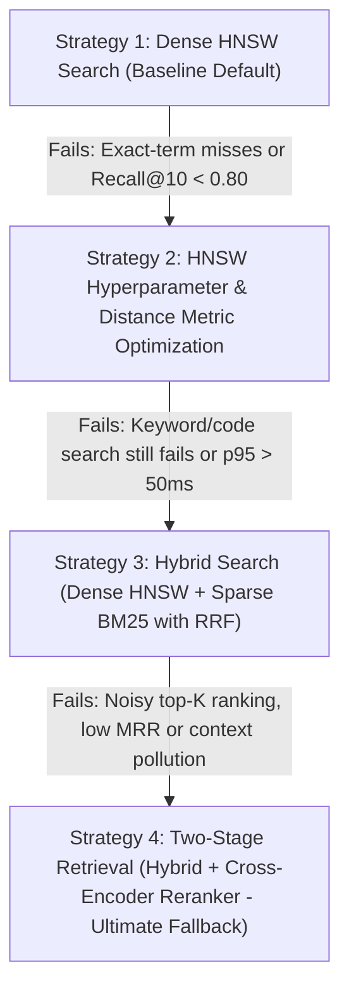

# Evaluate & Optimize Vector Search Skill

This skill provides a systematic framework for the AI Tech Lead and engineers to evaluate, diagnose, and optimize vector retrieval within our Node.js and HNSW-based vector database infrastructure.

---

## 1. Retrieval Benchmark Metrics & Quality Gates

Evaluate retrieval on a curated ground-truth dataset (minimum 50–100 realistic domain queries with labeled ground-truth chunks):

| Metric | Target SLA | Method Is Considered "Failed" / Không ổn Nếu |
| :--- | :--- | :--- |
| **Recall@10** | >= 0.85 | < 0.80 (fails to retrieve ground-truth chunks in Top-10) |
| **MRR (Mean Reciprocal Rank)** | >= 0.75 | < 0.65 (relevant chunk is pushed too far down the ranking list) |
| **Lexical / OOV Accuracy** | >= 90% | Fails on exact terms (error codes, product IDs, technical acronyms) |
| **Search Latency (p95)** | < 30 ms | p95 > 50 ms or p99 > 100 ms under 50 QPS load |
| **Context Relevance** | >= 0.80 | Retrieved chunks contain irrelevant noise that causes LLM hallucination |

---

## 2. Progressive Retrieval Strategy Decision Tree

When testing vector retrieval, start at **Strategy 1**. If failure criteria are triggered, progressively execute the fallback strategies:



---

### Strategy 1: Dense HNSW Vector Search (Baseline Default)

* **Architecture**: Dense vector embedding (e.g. `text-embedding-3-small`, 1536 dims) queried against an HNSW index.
* **Default Configuration**:
  - Distance Metric: `Cosine`
  - Index Parameters: `M = 16`, `efConstruction = 64`
  - Query Parameter: `efSearch = 40`, `Top-K = 20`
* **When It Works**: General conceptual queries, semantic question-answering where queries use synonyms or natural language expressions.

#### ⚠️ Failure Signals (Khi phương pháp này không ổn):
1. **Keyword Blindness**: Queries containing specific identifiers, error codes (e.g., `ERR_AUTH_04`), API function names (e.g., `verifyUserSession`), or part numbers fail to rank the exact matching chunk.
2. **Low Recall**: Recall@10 drops below 0.80 against exhaustive KNN ground truth.
3. Dense embeddings scatter rare tokens across general semantic concepts.

#### ➡️ Fallback Action:
If semantic recall is marginal (< 0.80) or graph traversal terminates prematurely, first transition to **Strategy 2 (HNSW Hyperparameter Tuning)**. If the core problem is exact keyword mismatch, skip directly to **Strategy 3 (Hybrid Search)**.

---

### Strategy 2: HNSW Hyperparameter & Index Tuning

* **Implementation**:
  1. Increase query-time exploration depth:
     - Tune `efSearch` from `40` -> `80` -> `128` (improves recall at slight latency cost).
  2. If recall remains below target, rebuild the HNSW index with denser connectivity:
     - Upgrade `M` from `16` -> `32` (doubles graph links per node).
     - Upgrade `efConstruction` from `64` -> `128` (more exhaustive graph construction).
  3. Pre-normalize embedding vectors ($L2$-norm $= 1.0$) and switch distance metric from `Cosine` to `DotProduct` to leverage SIMD vector hardware acceleration.

#### ⚠️ Failure Signals (Khi phương pháp này không ổn):
1. **Latency SLA Breach**: Increasing `efSearch` to 128 causes p95 latency to exceed 50ms under concurrent query load.
2. **Lexical Blindness Persists**: Despite high graph recall, pure vector representations still cannot guarantee exact keyword match for acronyms and code identifiers.

#### ➡️ Fallback Action:
Transition immediately to **Strategy 3 (Hybrid Search: Dense + Sparse)**.

---

### Strategy 3: Hybrid Search (Dense HNSW + Sparse BM25 / Full-Text)

* **Implementation**:
  1. Execute two parallel retrieval streams:
     - **Stream A (Dense)**: Top-30 candidates from HNSW vector similarity search.
     - **Stream B (Sparse)**: Top-30 candidates from BM25 full-text keyword index (e.g. PostgreSQL `tsvector`, Elasticsearch, or Qdrant sparse vectors).
  2. Fuse results using **Reciprocal Rank Fusion (RRF)**:
     $$RRF\_Score(d) = \frac{1}{60 + \text{rank}_{\text{dense}}(d)} + \frac{1}{60 + \text{rank}_{\text{sparse}}(d)}$$
  3. Sort by $RRF\_Score$ and select Top-20 candidates.
* **When It Works**: Workloads requiring both broad conceptual understanding and precise keyword/identifier matching.

#### ⚠️ Failure Signals (Khi phương pháp này không ổn):
1. **Ranking Inversion / Noise**: Blending sparse and dense ranks pushes high-quality semantic chunks down if they lack the exact keyword, while superficial keyword matches rank too high.
2. **MRR < 0.70**: The truly relevant chunk is present in the Top-20, but not positioned within the Top-3 candidates.
3. Sending the top-K directly to the LLM increases token cost and causes context poisoning / hallucination.

#### ➡️ Fallback Action:
Transition to **Strategy 4 (Two-Stage Retrieval with Cross-Encoder Reranker)** to guarantee optimal ordering.

---

### Strategy 4: Two-Stage Retrieval with Cross-Encoder Reranking (The Ultimate Fallback)

* **Implementation**:
  1. **Stage 1 (High Recall Retrieval)**:
     - Fetch candidate pool of `K = 30-50` chunks using Hybrid Search (Dense + Sparse).
  2. **Stage 2 (High Precision Scoring)**:
     - Pass the `(Query, Chunk)` pairs into a Cross-Encoder Reranker (e.g., Cohere Rerank v3 API or local BGE-Reranker via ONNX Runtime in Node.js).
     - The Cross-Encoder performs all-to-all cross-attention across query tokens and chunk tokens, producing a calibrated relevance score in $[0, 1]$.
  3. **Filtering & Slicing**:
     - Apply a minimum confidence threshold: drop all chunks with relevance score $< 0.60$.
     - Return the top `N = 3 - 5` chunks to the Prompt Context Assembler.

* **Why This Resolves Previous Failures**:
  - Overcomes the bi-encoder information bottleneck.
  - Neutralizes BM25 false positives and dense vector noise.
  - Consistently achieves MRR >= 0.85 and eliminates irrelevant context from reaching the LLM.

---

## 3. Step-by-Step Evaluation Workflow

When running this skill, execute the following diagnostic runbook:

### Step 1: Prepare the Evaluation Test Suite
Assemble a representative test set containing:
- 30 conceptual/paraphrased questions (semantic test).
- 20 specific queries with IDs, error codes, or function names (lexical test).
- Ground-truth chunk IDs mapped to each query.

### Step 2: Run Baseline Benchmark (Strategy 1)
Run the automated retrieval evaluation script:
```bash
npm run eval:retrieval -- --strategy=dense-hnsw --k=10
```

### Step 3: Check Metrics against Quality Gates
Inspect the output report:
1. Is Recall@10 >= 0.85?
2. Did exact keyword queries succeed (Lexical Recall >= 90%)?
3. Is latency p95 < 30ms?

### Step 4: Apply Decision Tree & Transition
- If exact keyword test failed -> Enable **Strategy 3 (Hybrid Search)**.
- If recall is low but queries are conceptual -> Test **Strategy 2 (HNSW Tuning)**.
- If MRR is sub-optimal or candidates contain noise -> Deploy **Strategy 4 (Reranker)**.

### Step 5: Update System Architecture & Config
Once the winning retrieval configuration is validated:
1. Update database indexing scripts and query handlers in `src/retrieval/`.
2. Update the system status and parameters in [ARCHITECTURE.md](file:///c:/Users/Dung%20Vu/Documents/AI%202026/RAG_Project/ARCHITECTURE.md).
