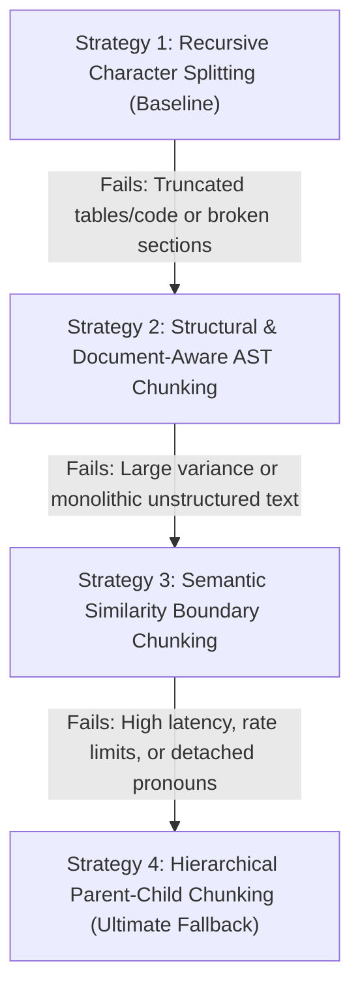

# Optimize Document Chunking Skill

This skill guides the AI Tech Lead and engineers through inspecting, testing, and optimizing chunking strategies for multi-format documents (Markdown, PDF, DOCX, Code, HTML) in our Node.js RAG architecture.

---

## 1. Quality Gates & Failure Criteria

Before adopting any chunking strategy, test a representative sample of documents against the following quantitative and qualitative gates:

| Metric | Target Threshold | Method Is Considered "Failed" / Không ổn Nếu |
| :--- | :--- | :--- |
| **Boundary Integrity** | >= 95% intact sentences | > 5% chunks cut sentences, tables, or code blocks in half |
| **Token Distribution** | Within [256, 800] tokens | Standard deviation > 300 tokens, or > 5% chunks < 100 or > 1000 tokens |
| **Metadata Preservation** | 100% chunks retain hierarchy | Lost section headers, parent titles, or source page numbers |
| **Contextual Completeness** | Semantic Cohesion >= 0.80 | Chunks contain detached pronouns ("it", "they") with missing referents |
| **Retrieval Recall@5** | >= 0.85 on test Q&A pairs | Target chunk not found in top 5 retrieval results |

---

## 2. Progressive Chunking Strategy Decision Tree

When evaluating a document set, start at **Strategy 1**. If the failure criteria are triggered, progressively fall back to the next strategy:



---

### Strategy 1: Recursive Character Splitting (Baseline)

* **Implementation**: Split by recursive separator list: `["\n\n", "\n", ". ", " ", ""]`.
* **Default Params**: Target size `512` tokens, overlap `10% - 15%` (50–80 tokens).
* **When It Works**: Plain prose, blogs, articles without deep hierarchical structures or embedded code/tables.

#### ⚠️ Failure Signals (Khi phương pháp này không ổn):
1. Code blocks or markdown tables are sliced mid-row or mid-function.
2. Section headers appear as orphaned chunks at the end of a chunk or split from their body.
3. Boundary integrity drops below 95%.

#### ➡️ Fallback Action:
**Stop using recursive character splitting** for this document class and switch immediately to **Strategy 2 (Structural & AST Chunking)**.

---

### Strategy 2: Structural & Document-Aware AST Chunking

* **Implementation**: Parse the document AST (Markdown AST via `remark`/`mdast`, HTML via `cheerio`, or PDF structural layout).
* **Mechanism**:
  - Split on Markdown headers (`#`, `##`, `###`).
  - Keep tables, code blocks, and lists as indivisible atomic nodes.
  - Inject document breadcrumbs into metadata and prefix each chunk with its context path:
    ```markdown
    [Document: API_Guide.md > Section: Authentication > Sub: OAuth2 Tokens]
    Content of chunk...
    ```
* **When It Works**: Well-structured technical docs, manuals, API references, Markdown repositories.

#### ⚠️ Failure Signals (Khi phương pháp này không ổn):
1. **Unbalanced Chunks**: Documents have long sections without subheaders (> 1500 tokens), causing single chunks to exceed embedding model context limits.
2. **Micro-chunks**: Frequent bullet points or sub-items create tiny chunks (< 50 tokens) that carry insufficient context for vector search.
3. Token variance standard deviation exceeds 300 tokens.

#### ➡️ Fallback Action:
If the document lacks clean structural tags or has massive sections with internal topic shifts, switch to **Strategy 3 (Semantic Similarity Boundary Chunking)**.

---

### Strategy 3: Semantic Similarity Boundary Chunking

* **Implementation**:
  1. Break text into individual sentences using a sentence tokenizer.
  2. Generate dense embeddings for sequential sentences or sliding sentence windows.
  3. Calculate the Cosine Distance between adjacent sentence embeddings:
     $$\text{Distance}(S_i, S_{i+1}) = 1 - \text{CosineSimilarity}(E(S_i), E(S_{i+1}))$$
  4. Place a chunk split point wherever the distance exceeds the 90th percentile threshold or a statistically significant drop occurs.
* **When It Works**: Unstructured narrative documents, transcripts, legal contracts, or monolithic documents without headers.

#### ⚠️ Failure Signals (Khi phương pháp này không ổn):
1. **Ingestion Latency & Cost**: High embedding API overhead during ingestion (requires $N$ sentence embeddings before vector storage).
2. **Context Fragmentation**: Chunks capture isolated propositions but lose overarching context, resulting in pronoun resolution failure ("It specifies that..." without knowing what "It" is).
3. Ingestion throughput falls below the required SLA (< 10 pages/second).

#### ➡️ Fallback Action:
Switch to **Strategy 4 (Hierarchical Parent-Child Chunking)** to completely decouple retrieval granularity from generation context.

---

### Strategy 4: Hierarchical Parent-Child Chunking (The Ultimate Fallback)

* **Implementation**:
  - **Child Chunks (Granular)**: 128–256 tokens with 20-token overlap. Stored with vector embeddings in the HNSW index for high-precision semantic matching.
  - **Parent Chunks (Broad)**: 1024–2048 tokens containing the broader context, surrounding paragraphs, and full section context.
  - **Linking**: Child chunks store `parent_id` foreign key referencing the parent chunk in `document_chunks`.
* **Execution Flow**:
  1. Vector search matches the specific, fine-grained **Child Chunk**.
  2. System resolves and fetches the enclosing **Parent Chunk** by `parent_id`.
  3. Pass the **Parent Chunk** to the Context Assembler and LLM prompt.
* **Why This Resolves Previous Failures**:
  - Overcomes the trade-off between small chunks (great for vector match precision) and large chunks (great for LLM comprehension).
  - Eliminates detached pronouns and truncated references.

---

## 3. Step-by-Step Optimization Workflow

When running this skill, execute the following steps:

### Step 1: Run Document Profiling
Analyze document types, average length, presence of code/tables, and existing header hierarchy.

### Step 2: Generate Evaluation Chunks with Strategy 1
Run baseline chunker on a test slice:
```bash
# Example test script in project
npm run test:chunking -- --strategy=recursive --sample=5
```

### Step 3: Compute Audit Metrics
Inspect chunk boundaries:
1. Count chunks exceeding 1000 tokens or below 100 tokens.
2. Check if table rows (`|---|`) or code blocks (```` ``` ````) are split across chunk boundaries.
3. Test retrieval recall using 10 golden test queries.

### Step 4: Apply Decision Tree & Transition
- If Strategy 1 fails -> Apply Strategy 2.
- If Strategy 2 fails -> Apply Strategy 3.
- If Strategy 3 fails -> Deploy Strategy 4 (Parent-Child).

### Step 5: Persist Configuration & Update `ARCHITECTURE.md`
Once optimal chunking parameters are confirmed, update the chunker configuration in `src/ingestion/` and document the chosen strategy in [ARCHITECTURE.md](file:///c:/Users/Dung%20Vu/Documents/AI%202026/RAG_Project/ARCHITECTURE.md).
