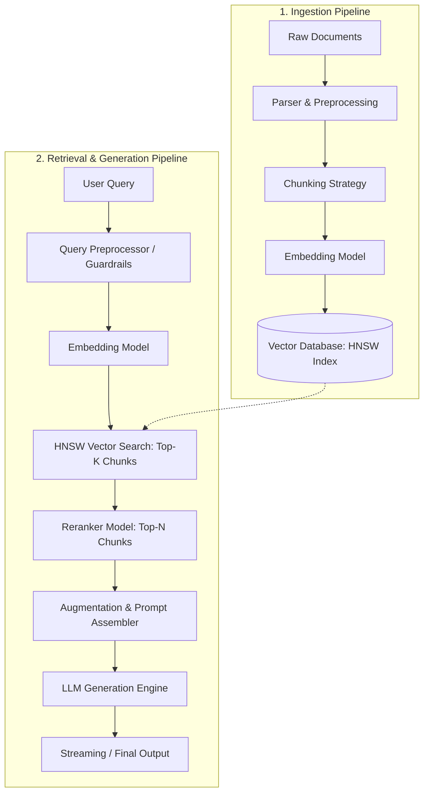

# System Architecture: Enterprise RAG (Retrieval-Augmented Generation)

## 1. Executive Overview

This document outlines the end-to-end architecture, data flows, database schemas, technology stack, and implementation milestones for the Retrieval-Augmented Generation (RAG) system, built as polyglot microservices: a React SPA, a Node.js (Fastify) API Gateway, a Python (FastAPI) RAG Engine, MongoDB for metadata, and Qdrant for vectors.

The system is designed to provide high-precision semantic retrieval and grounded generation by combining:
- Optimized document parsing and chunking.
- High-dimensional vector embeddings stored with **HNSW (Hierarchical Navigable Small World)** indexing for sub-millisecond approximate nearest neighbor (ANN) search.
- Two-stage retrieval featuring vector similarity search and Cross-Encoder / Model-based Reranking.
- Grounded contextual augmentation with hallucination guardrails.
- Streaming LLM generation for responsive real-time client interaction.

---

## 2. System Pipelines & Data Flow

### 2.1 High-Level Architecture Diagram



### 2.2 Pipeline Breakdown

#### Phase A: Ingestion Pipeline (Offline / Asynchronous)
1. **Documents**: Ingest multi-format documents (PDF, DOCX, Markdown, Text, HTML).
2. **Chunking**: Break texts into semantically coherent segments using recursive character splitting or semantic chunking with configurable overlap (e.g., 512–1024 tokens with 10–20% overlap).
3. **Embedding Model**: Transform text chunks into dense vector representations (e.g., `text-embedding-3-small` / `text-embedding-3-large`, 1536/3072 dims).
4. **Vector Database (HNSW)**: Store chunk embeddings and payloads into a vector database using an HNSW graph index for rapid vector distance calculation (Cosine Similarity / DotProduct / Euclidean).

#### Phase B: Retrieval & Generation Pipeline (Online / Real-time)
1. **User Query**: Receive user prompt via REST (JSON) or Server-Sent Events (SSE) streaming.
2. **Embedding Model**: Convert the user's query into the same vector space as the stored chunks.
3. **Retrieval in Vector Database**: Query the HNSW index to retrieve the `Top-K` candidate chunks (e.g., `K = 20-50`) using approximate nearest neighbor search.
4. **Rerank the Chunks**: Pass candidate chunks and the user query to a cross-encoder / reranking model (e.g., Cohere Rerank, BGE-Reranker) to filter and order the top `Top-N` most relevant chunks (e.g., `N = 3-5`).
5. **Augmentation**: Assemble a structured prompt injecting retrieved chunks as authoritative context, query metadata, system guardrails, and conversation history.
6. **LLM for Generation**: Feed the augmented prompt to the LLM (e.g., Claude 3.5 Sonnet, GPT-4o, or Gemini 1.5 Pro) with streaming enabled.
7. **Output**: Stream response tokens back to the client along with cited chunk references and relevance scores.

### 2.3 Modular Data Flow Chains
- **Document Ingestion & Indexing Chain**:
  `frontend DocumentPanel.tsx -> useDocuments.ts -> documents.api.ts (POST multipart) -> Nginx /api -> api/src/routes/documents.route.ts (upload) -> utils/source-type.ts (resolveSourceType / 415) -> deduplication.service.ts (SHA-256; failed -> retry) -> rag-engine.client.ts (processAndIndex) -> rag_engine/api/routes/ingestion.py (/process) -> parser_factory.py (get_parser) -> chunking.py (split_document) -> embeddings/factory.py (get_embedding_provider) -> embeddings/openai_provider.py (batching + tenacity retry) -> vectordb/vector_ops.py (upsert_chunks_to_qdrant) -> vectordb/qdrant_client.py`
- **Vector Deletion by Document Chain**:
  `api/src/routes/documents.route.ts (DELETE /documents/:id) -> rag-engine.client.ts (deleteVectors) -> rag_engine/api/routes/vectordb.py (DELETE /vectors/document/{document_id}) -> vectordb/vector_ops.py (delete_vectors_by_document_id) -> vectordb/qdrant_client.py`
- **Batch Embedding Generation Chain**:
  `rag_engine/api/routes/embeddings.py (POST /batch) -> embeddings/factory.py -> embeddings/openai_provider.py (embed_batch)`
- **Two-Stage Retrieval & Reranking Chain**:
  `api/src/routes/retrieval.route.ts (POST /api/v1/retrieval/search) -> rag-engine.client.ts (retrieveAndRerank) -> rag_engine/api/routes/retrieval.py (POST /search) -> retrieval/retriever.py (VectorRetriever) -> embeddings/factory.py (get_embedding_provider) -> embeddings/openai_provider.py / mock_provider.py (embed_query) -> vectordb/vector_ops.py (search_vectors_with_hnsw với efSearch + Qdrant Filter) -> rerankers/factory.py (get_reranker_provider) -> rerankers/cohere_provider.py / mock_provider.py (rerank) -> fallback (vector_score sort on outage) -> RetrievalResponse`
- **Standalone Generation Streaming Chain**:
  `api/src/services/rag-engine.client.ts -> rag_engine/api/routes/generation.py (POST /api/v1/generate/stream) -> llm/factory.py (get_llm_provider) -> llm/openai_provider.py / mock_provider.py (generate_stream) -> generation/streamer.py (sse_event_generator) -> SSE (citations -> token* -> done)`
- **Full End-to-End RAG Query Streaming Chain**:
  `frontend ChatPanel.tsx -> useChat.ts -> query.api.ts (fetch POST) -> Nginx /api/v1/query/stream (proxy_buffering off) -> api/src/routes/query.route.ts (POST /api/v1/query/stream) -> rag-engine.client.ts (streamQuery) -> rag_engine/api/routes/generation.py (POST /api/v1/query/stream) -> generation/query_pipeline.py (RAGQueryPipeline) -> retrieval/retriever.py (retrieve_and_rerank) -> prompting/augmenter.py (assemble) -> llm/factory.py (get_llm_provider) -> llm/openai_provider.py / mock_provider.py (generate_stream) -> generation/streamer.py (sse_event_generator) -> Fastify Readable.fromWeb pipe -> lib/sse-parser.ts (readSseStream) -> MessageBubble.tsx ([n] badges) + CitationList.tsx`
- **Non-Streaming RAG Query Chain**:
  `api/src/routes/query.route.ts (POST /api/v1/query) -> rag-engine.client.ts (streamQuery) -> rag_engine /api/v1/query/stream -> services/sse-collector.ts (collectSseAnswer) -> JSON {answer, citations, token_usage}`
- **Document Library & Deletion (UI) Chain**:
  `DocumentPanel.tsx -> useDocuments.ts -> documents.api.ts (GET / DELETE) -> documents.route.ts -> Vector Deletion by Document Chain`
- **End-to-End System Test Chain**:
  `api/test_e2e_flow.mjs -> ADMIN (:3000 documents + :8000 collection info) -> USER (:80 Nginx SPA + /api/v1/query/stream + /api/v1/query + /api/v1/retrieval/search) -> ADMIN cleanup (DELETE -> vectors purged)`
- **API Gateway Startup Chain**:
  `api/src/server.ts -> config/env.config.ts (zod: JWT_*, BCRYPT_COST, ADMIN_*) -> config/database.ts (mongoose.connect) -> auth.service.ts (ensureAdminAccount) -> @fastify/cookie -> register routes -> listen`
- **Registration / Login Chain**:
  `AuthPage.tsx -> useAuth.tsx -> auth.api.ts (POST /auth/register|login) -> Nginx -> routes/auth.route.ts (Zod: email, password 8–72 bytes, letters+digits) -> auth.service.ts -> password.service.ts (bcrypt cost 11 / dummy compare) -> models/user.model.ts (MongoDB users) -> token.service.ts (signAccessToken HS256 15m + issueRefreshToken 7d -> refresh_tokens SHA-256) -> Set-Cookie rag_refresh (HttpOnly, SameSite=Strict, Path=/api/v1/auth) + JSON access_token -> lib/token-store.ts (memory)`
- **Authenticated Request Chain**:
  `api/http.ts (apiFetch: Authorization Bearer) -> middlewares/auth.middleware.ts (requireAuth: verifyAccessToken -> requireRole('admin') for POST/DELETE documents) -> route handler | 401 -> http.ts refreshSession (single-flight) -> retry once | refresh fails -> notifySessionExpired -> AuthPage`
- **Refresh Rotation Chain**:
  `http.ts refreshSession -> POST /auth/refresh (cookie) -> auth.service.refresh -> token.service.rotateRefreshToken (findOneAndUpdate revoke old jti, replaced_by -> issue new) -> users lookup -> new access token + rotated cookie | revoked token replayed after REFRESH_REUSE_GRACE_SECONDS -> revokeAllRefreshTokens -> 401 TOKEN_REUSED`
- **Logout Chain**:
  `UserBar.tsx -> useAuth.logout -> auth.api.logout (POST /auth/logout) -> token.service.revokeRefreshToken -> clearCookie -> token-store cleared -> AuthPage`
- **Optimized Query Chain (Phase 8)**:
  `query_pipeline.resolve_retrieval_query (query_rewriter, follow-ups only) -> retrieve (embed -> Qdrant gRPC top_k=50 -> Cohere rerank-multilingual top_n=3) -> augment (system_prompt v2) -> gpt-4o-mini stream -> streamer (done: used_citation_ids, retrieval_query) -> CitationList (cited sources only)`
- **Scanned PDF Ingestion Chain**:
  `ingestion/indexer.index_document -> pdf_parser -> pdf_ocr.ocr_missing_pages (pages < 50 chars -> PNG 150 dpi -> gpt-4o-mini vision, SHA-256 disk cache) -> DocumentChunker (256/32) -> embed -> upsert`
- **Query Monitoring Chain**:
  `query.route.ts -> SseObserver (TTFT, answer, citations, usage) -> query-log.service.recordQuery -> MongoDB query_logs | admin.route.ts GET /api/v1/admin/metrics -> $percentile p50/p95/p99`
- **Evaluation Chain**:
  `evaluation/run_eval index (corpus -> eval_cs<size>_ov<overlap>_h<0|1>) -> build-dataset (LLM Q/A + verbatim evidence) -> retrieval-sweep (CandidateCache: 1 rerank call/question -> offline grid) -> generate-eval (pipeline.augment -> LLM -> llm_judge) -> reports/*.md|json`
- **Engine Startup Chain**:
  `api/main.py lifespan -> ensure_collection_exists -> api/warmup.warm_up_providers (embedding / LLM / Cohere client prebuilt) -> ready`

---

## 3. Vector Database & HNSW Configuration

### 3.1 HNSW (Hierarchical Navigable Small World) Indexing Parameters
HNSW builds a multi-layer graph where bottom layers contain all elements and top layers contain sparse skip-lists for logarithmic time complexity search:

| Parameter | Recommended Setting | Description |
| :--- | :--- | :--- |
| **Distance Metric** | `Cosine` or `DotProduct` | Standard metric for normalized text embeddings |
| **`M`** | `16` - `32` | Maximum number of bidirectional links per node in the graph |
| **`efConstruction`** | `64` - `128` | Search depth during index building (higher = better recall, slower build) |
| **`efSearch`** | `40` - `100` | Search depth during query time (higher = higher recall, higher latency) |

---

## 4. Database Schemas

### 4.1 Documents Collection (`documents` — MongoDB)
Tracks raw source files and their lifecycle. Written by the API Gateway (`api/src/models/document.model.ts`), validated by `db/mongo_init/001_init_collections.js`.

```javascript
// MongoDB document shape (Mongoose model + $jsonSchema validator)
{
  id: "UUID",                    // String, unique — shared key with Qdrant payload.document_id
  title: "report.pdf",           // String, required
  source_type: "pdf",            // required enum: 'pdf' | 'docx' | 'markdown' | 'text' | 'html' | 'url'
  source_url: "https://...",     // String, optional (omitted when absent — null is rejected)
  file_hash: "sha256-hex",       // String, required, unique index — SHA-256 deduplication
  total_chunks: 12,              // Int
  total_tokens: 4096,            // Int
  status: "completed",           // required enum: 'pending' | 'processing' | 'completed' | 'failed'
  metadata: { original_filename, file_size_bytes, mimetype },
  createdAt: ISODate, updatedAt: ISODate   // Mongoose timestamps
}
// Indexes: file_hash (unique), status, created_at desc
```

### 4.2 Chunks Storage (Qdrant Vector DB)
Stores segment text, metadata payload, and vector embedding indexed with HNSW.
> **Architectural Decision**: Chunks are stored directly in Qdrant (vectors + payload), NOT in MongoDB. This eliminates dual-write overhead and sync inconsistency.

```json
// Qdrant Point Payload Structure
{
  "id": "550e8400-e29b-41d4-a716-446655440000",
  "vector": [0.012, -0.045, 0.089, "... 1536 dims ..."],
  "payload": {
    "document_id": "UUID-of-document",
    "chunk_index": 0,
    "content": "Text content of the chunk segment...",
    "token_count": 256,
    "source_type": "pdf",
    "page_number": 1,
    "section_title": "1. Introduction",
    "created_at": "2026-10-08T12:00:00Z"
  }
}
```

### 4.3 Query Audit & Evaluation Log (`query_logs` — MongoDB)
Captures user queries, retrieved chunks, generated responses, and quality metrics. Collection + validator provisioned by `db/mongo_init/001_init_collections.js` (writer to be implemented in Phase 8 monitoring).

```javascript
{
  user_query: "String",               // required
  retrieved_chunk_ids: ["qdrant-uuid"],
  rerank_scores: { },                 // Object
  generated_response: "String",
  latency_ms: 850,                    // Int
  token_usage: { prompt_tokens, completion_tokens, total_tokens },
  feedback_score: 1,                  // Int, optional: -1 | 0 | +1
  created_at: ISODate
}
// Indexes: created_at desc, feedback_score (sparse), TTL 90 days on created_at
```

### 4.4 Users Collection (`users` — MongoDB)
Registered accounts. Written by `api/src/models/user.model.ts`; validator in `db/mongo_init/001_init_collections.js` (fresh volumes only).

```javascript
{
  id: "UUID",                     // String, unique
  email: "user@example.com",      // String, unique, lowercased
  name: "Alice",
  password_hash: "$2a$11$...",    // bcrypt only (validator pattern ^\$2[aby]\$) — never returned by the API
  role: "user",                   // enum: 'user' | 'admin' — self-registration is always 'user'
  last_login_at: ISODate,
  createdAt: ISODate, updatedAt: ISODate
}
// Indexes: id (unique), email (unique), role
```

### 4.5 Refresh Tokens Collection (`refresh_tokens` — MongoDB)
One row per issued refresh token, enabling rotation, logout revocation and reuse detection.

```javascript
{
  jti: "UUID",                    // JWT ID, unique
  user_id: "UUID",
  token_hash: "sha256-hex",       // SHA-256 of the raw JWT — the token itself is never stored
  expires_at: ISODate,            // TTL index (expireAfterSeconds: 0) purges expired rows
  revoked_at: ISODate,            // set on rotation / logout / reuse detection
  replaced_by: "UUID",            // jti of the token issued on rotation
  user_agent: "String",
  createdAt: ISODate
}
// Indexes: jti (unique), user_id, expires_at (TTL)
```

---

## 5. Technology Stack (Confirmed)

### Services & Runtime
| Service | Technology | Port | Role |
| :--- | :--- | :--- | :--- |
| **frontend** | React + Vite → Nginx 1.27 | `80` | User Interface (SPA) |
| **api** | Node.js v20 LTS + Fastify + TypeScript 5.x | `3000` | API Gateway & Orchestration |
| **rag_engine** | Python 3.11 + FastAPI + Uvicorn | `8000` | Core RAG Pipeline (ML-heavy) |
| **mongodb** | MongoDB 7.0 | `27017` | Document Metadata & Query Logs |
| **qdrant** | Qdrant v1.9.3 | `6333/6334` | Vector Storage (HNSW Index) |

### 5.1 Technology Decisions
- **Vector Database**: **Qdrant** (HNSW, Cosine similarity, 1536-dim embeddings). Qdrant stores chunk vector embeddings directly alongside text and metadata in point payloads.
- **Metadata Store**: **MongoDB 7.0** — stores `documents` (with `file_hash` SHA-256 for deduplication), `query_logs`, `users` and `refresh_tokens`. Chunks are not stored in MongoDB.
- **Deduplication Engine**: **Node.js API Gateway** — hashes incoming file with SHA-256, checks MongoDB for existing `file_hash`. Idempotent return (200 OK with existing document ID) avoids redundant downstream processing.
- **Embedding Provider**: OpenAI `text-embedding-3-small` (1536 dims) or Cohere Embed v3.
- **Reranking Engine**: Cohere Rerank v3 (cloud) or BGE-Reranker via ONNX Runtime (local fallback).
- **LLM Orchestration**: Native SDKs — `openai`, `@google/genai`, `@anthropic-ai/sdk`. No LangChain (reduces abstraction overhead).
- **Validation**: Zod (Node.js) + Pydantic v2 (Python) for runtime schema enforcement.
- **Document Parsers**: PyMuPDF (PDF), python-docx (DOCX), markdown-it-py (Markdown AST), BeautifulSoup4 (HTML).
- **Authentication**: `jsonwebtoken` 9.0.2 — AccessToken (HS256, 15 min, `Authorization: Bearer`, kept in browser memory) + RefreshToken (HS256, separate secret & audience, 7 days, httpOnly `SameSite=Strict` cookie scoped to `/api/v1/auth`, rotated on every use, stored hashed, reuse ⇒ revoke all sessions). `@fastify/cookie` 9.4.0.
- **Password Hashing**: `bcryptjs` 2.4.3 (pure JS, no native build), cost 11 ≈ 250 ms per hash in the API container; passwords limited to 72 UTF-8 bytes (bcrypt input limit); dummy compare on unknown emails to prevent user enumeration by timing.
- **Authorization**: role `admin` → upload/delete documents; any authenticated user → list documents, query, retrieval search, augmentation. Bootstrap admin from `ADMIN_EMAIL` / `ADMIN_PASSWORD`.
- **Tuned RAG parameters (Phase 8, measured on 5 PDFs / 59 questions — see §6)**: chunk 256 tokens / 32 overlap (no breadcrumb header), `RETRIEVAL_TOP_K=50`, `RERANK_TOP_N=3`, `RERANK_MIN_SCORE=0`, `QUERY_REWRITE_ENABLED=true`, `SYSTEM_PROMPT_VERSION=v2`, `LLM_MODEL=gpt-4o-mini`, `RERANKER_MODEL=rerank-multilingual-v3.0`.
- **Qdrant transport**: gRPC (`QDRANT_PREFER_GRPC=true`, port 6334) — 2.4 ms vs 48 ms per search over REST (TCP delayed-ACK on large JSON bodies).
- **Scanned PDFs**: OCR fallback with `gpt-4o-mini` vision for pages without a text layer (~$0.0056/page, cached).

### 5.2 Directory Dictionary
- `rag_engine/config.py`: Centralized Pydantic settings loading and validating environment variables, HNSW hyperparameters, and chunk defaults without hardcoded values.
- `rag_engine/schemas/embedding.py`: Pydantic models defining batch embedding requests, item vectors, and point DTOs.
- `rag_engine/schemas/vectordb.py`: Pydantic models defining vector upsert, deletion payloads, collection metadata, and ingest responses.
- `rag_engine/embeddings/base.py`: Abstract Base Class defining standard interface for embedding providers.
- `rag_engine/embeddings/mock_provider.py`: Deterministic offline mock embedding provider generating 1536-dimensional L2-normalized vectors.
- `rag_engine/embeddings/openai_provider.py`: Production embedding client generating embeddings via OpenAI API with batching and exponential backoff retry.
- `rag_engine/embeddings/factory.py`: Provider factory instantiating OpenAI or Mock embedding provider based on environment configuration.
- `rag_engine/vectordb/qdrant_client.py`: Singleton connection manager managing asynchronous lifecycle and health checks for Qdrant client.
- `rag_engine/vectordb/collection_manager.py`: Collection lifecycle manager ensuring Qdrant collections and HNSW indices are provisioned.
- `rag_engine/vectordb/vector_ops.py`: Vector data operations executing chunk point upserts and payload-filtered vector deletions.
- `rag_engine/api/routes/embeddings.py`: FastAPI route handlers exposing batch embedding generation endpoints.
- `rag_engine/api/routes/vectordb.py`: FastAPI route handlers exposing collection management and vector deletion endpoints.
- `rag_engine/api/routes/ingestion.py`: FastAPI route handlers executing multi-format document parsing, chunking, and vector indexing.
- `rag_engine/tests/test_embeddings.py`: Automated integration test verifying embedding normalization, determinism, and factory fallback.
- `rag_engine/tests/test_qdrant_ops.py`: Automated integration test verifying Qdrant HNSW configuration, point upsert, and payload filtering.
- `rag_engine/tests/test_end_to_end_ingest.py`: End-to-end integration test validating file parsing, chunking, embedding, and vector assembly.
- `rag_engine/schemas/retrieval.py`: Pydantic models defining metadata filters, query requests, scored candidate chunks, and retrieval responses.
- `rag_engine/rerankers/base.py`: Abstract Base Class defining standard interface for Reranker providers.
- `rag_engine/rerankers/mock_provider.py`: Deterministic offline mock reranker calculating token overlap and bounded scores for CI/CD test execution.
- `rag_engine/rerankers/cohere_provider.py`: Production client communicating with Cohere Rerank v3 API with exponential backoff retry.
- `rag_engine/rerankers/onnx_provider.py`: Local cross-encoder executing BGE-Reranker model inference via ONNX Runtime.
- `rag_engine/rerankers/factory.py`: Provider factory resolving Cohere, ONNX, or Mock reranker based on configuration and credential presence.
- `rag_engine/retrieval/retriever.py`: Core retrieval orchestrator coordinating query embedding, Qdrant HNSW ANN search, metadata filtering, cross-encoder reranking, and graceful fallbacks.
- `rag_engine/api/routes/retrieval.py`: FastAPI route handlers exposing vector similarity retrieval and reranking search endpoints.
- `rag_engine/tests/test_retrieval_ops.py`: Automated integration test verifying HNSW query-time efSearch tuning, metadata filtering, reranker scoring, and fallback handling.
- `rag_engine/tests/test_api_retrieval.py`: Automated API integration test validating FastAPI retrieval endpoints and validation behavior.
- `api/src/services/rag-engine.client.ts`: Node.js HTTP client forwarding multipart file buffers, vector operations, and retrieval query requests to Python RAG Engine.
- `api/src/routes/documents.route.ts`: Fastify route handlers managing document upload lifecycle, SHA-256 deduplication, and vector purging.
- `api/src/routes/retrieval.route.ts`: Fastify route handlers exposing retrieval and reranking search endpoints with Zod schema validation.
- `api/test_retrieval_route.mjs`: Integration test verifying Fastify retrieval route schema validation and payload forwarding.
- `rag_engine/schemas/augmentation.py`: Pydantic models defining chat messages, citation metadata, token budget auditing, and augmented prompt DTOs.
- `rag_engine/prompting/system_prompt.py`: Modular system prompt builder enforcing strict anti-hallucination, grounding, and citation rules.
- `rag_engine/prompting/context_assembler.py`: Context Assembler formatting chunks into XML `<context>` with numbered citation tags and provenance metadata.
- `rag_engine/prompting/token_budget.py`: Token Budget Manager auditing token consumption with chunk-level priority truncation.
- `rag_engine/prompting/augmenter.py`: Prompt Augmenter orchestrator combining System Prompt, Token Budgeting, Context Assembly, and Message sequencing.
- `rag_engine/api/routes/augmentation.py`: FastAPI route handlers exposing prompt assembly, context augmentation, and token budget auditing endpoints.
- `rag_engine/tests/test_augmentation.py`: Automated integration test verifying grounding rules, citation numbering, token truncation, and API endpoints.
- `api/src/routes/augmentation.route.ts`: Fastify route handlers exposing prompt assembly and context augmentation endpoints with Zod validation.
- `api/test_augmentation_route.mjs`: Integration test verifying Fastify augmentation route schema validation and payload forwarding.
- `rag_engine/schemas/generation.py`: Pydantic models defining generation requests, SSE streaming events, token usage metrics, and query pipeline DTOs.
- `rag_engine/llm/base.py`: Abstract Base Class defining standard interface for LLM providers with streaming generator support.
- `rag_engine/llm/mock_provider.py`: Deterministic offline Mock LLM provider streaming responses with citations [1], [2] for CI/CD test execution.
- `rag_engine/llm/openai_provider.py`: Production LLM client interfacing with OpenAI Chat Completions API with streaming deltas and tenacity retry.
- `rag_engine/llm/gemini_provider.py`: Production LLM client interfacing with Google Gemini API with token streaming.
- `rag_engine/llm/anthropic_provider.py`: Production LLM client interfacing with Anthropic Claude API with token streaming.
- `rag_engine/llm/factory.py`: Provider factory resolving OpenAI, Gemini, Anthropic, or Mock provider with graceful fallback.
- `rag_engine/generation/streamer.py`: Server-Sent Events (SSE) serializer and streaming lifecycle orchestrator ('citations' -> 'token'* -> 'done').
- `rag_engine/generation/query_pipeline.py`: End-to-end RAG query orchestrator tying retrieval, prompt augmentation, LLM streaming, and SSE formatting with outage resilience.
- `rag_engine/api/routes/generation.py`: FastAPI route handlers exposing standalone LLM generation and full RAG query streaming endpoints.
- `rag_engine/tests/test_generation.py`: Automated integration test verifying MockLLMProvider streaming, SSE frame format, citations, and FastAPI routes.
- `api/src/routes/query.route.ts`: Fastify route handler proxying SSE stream from RAG Engine to client for POST /api/v1/query/stream with Zod validation.
- `api/test_query_stream_route.mjs`: Integration test for Node.js API Gateway verifying SSE query streaming proxy and schema validation.
- `api/src/config/database.ts`: Mongoose connection lifecycle (connect on startup, disconnect on shutdown).
- `api/src/utils/source-type.ts`: Maps upload file extensions to the canonical MongoDB `source_type` enum.
- `api/src/services/sse-collector.ts`: Parses RAG Engine SSE frames and aggregates them into a single JSON answer.
- `api/test_query_route.mjs`: Integration test for compiled query routes (SSE parsing, JSON aggregation, filter forwarding).
- `api/test_documents_route.mjs`: Integration test for compiled document routes with stubbed Mongoose (415, dedup, failed-retry, source_type).
- `api/test_e2e_flow.mjs`: End-to-end test against the running stack covering the admin flow (upload/415/list/dedup/Qdrant counts/delete/404) and the user flow (SPA via Nginx, SSE, scoped & multi-turn query, JSON query, retrieval search).
- `api/src/models/user.model.ts`: Mongoose model for user accounts (`users`), with `toPublicUser()` stripping the password hash.
- `api/src/models/refresh-token.model.ts`: Mongoose model for issued refresh tokens (`refresh_tokens`, SHA-256 hash, TTL index).
- `api/src/services/password.service.ts`: bcrypt hashing / verification with timing-equalizing dummy hash.
- `api/src/services/token.service.ts`: JWT AccessToken / RefreshToken signing, verification, rotation, revocation, reuse detection.
- `api/src/services/auth.service.ts`: Register, login, refresh, logout, current-user lookup and bootstrap admin creation.
- `api/src/middlewares/auth.middleware.ts`: Fastify preHandlers `requireAuth` (Bearer JWT) and `requireRole(...)`.
- `api/src/routes/auth.route.ts`: `/api/v1/auth/register|login|refresh|logout|me` with Zod validation and refresh cookie handling.
- `api/src/utils/auth-error.ts`: Typed auth error (HTTP status + machine code) mapped to JSON responses.
- `api/test_auth.mjs`: Auth integration test against real MongoDB (hash time, validation, JWT tamper/audience, rotation, reuse, logout, roles).
- `frontend/src/lib/token-store.ts`: In-memory access token holder and session-expired event bus.
- `frontend/src/api/auth.api.ts`: Client for register / login / logout / me endpoints.
- `frontend/src/hooks/useAuth.tsx`: AuthProvider context restoring the session from the refresh cookie and exposing auth actions.
- `frontend/src/components/AuthPage.tsx`: Login / registration screen with client-side password rules.
- `frontend/src/components/UserBar.tsx`: Signed-in user badge (name, email, role) with logout.
- `api/src/models/query-log.model.ts`: Mongoose model for `query_logs` (latency, TTFT, tokens, chunk scores); indexes owned by db/mongo_init.
- `api/src/services/query-log.service.ts`: SSE observer + fire-and-forget query log writer.
- `api/src/routes/admin.route.ts`: Admin-only `GET /api/v1/admin/metrics` (p50/p95/p99 latency & TTFT, tokens, error rate, slowest queries).
- `rag_engine/api/warmup.py`: Startup warm-up building providers/HTTP clients (removes ~5 s `import cohere` from the first query).
- `rag_engine/ingestion/indexer.py`: Shared Parse → OCR → Chunk → (header) → Embed → Upsert pipeline used by the API and evaluation.
- `rag_engine/ingestion/contextual_header.py`: Optional "Document > Section > Page" breadcrumb for embedding / reranking text.
- `rag_engine/ingestion/pdf_ocr.py`: OpenAI-vision OCR fallback for scanned PDF pages with on-disk cache.
- `rag_engine/generation/query_rewriter.py`: Condenses follow-up questions into standalone retrieval queries.
- `rag_engine/evaluation/run_eval.py`: Phase 8 CLI (index, build-dataset, retrieval-sweep, generate-eval) writing reports.
- `rag_engine/evaluation/corpus.py`: Indexes an eval corpus into per-chunk-config eval collections.
- `rag_engine/evaluation/dataset_builder.py`: LLM-generated questions with verbatim evidence (factual / paraphrase / follow-up / unanswerable).
- `rag_engine/evaluation/candidates.py`: Cached candidate pools (one rerank call per question) + offline config simulation + Cohere 429 backoff.
- `rag_engine/evaluation/llm_judge.py`: LLM-as-judge (groundedness, context / answer relevance, correctness, refusal).
- `rag_engine/evaluation/retrieval_metrics.py`: Hit@k, MRR, nDCG@k.
- `rag_engine/evaluation/evidence.py`: Chunk-config-independent relevance labels via evidence token recall.
- `rag_engine/evaluation/cost_tracker.py`: Token/USD accounting with budget hard stop (`EVAL_BUDGET_USD`).
- `rag_engine/evaluation/openai_json.py`: JSON-mode OpenAI helper with retry and cost tracking.
- `rag_engine/evaluation/datasets/main.json`: The 59-question evaluation dataset (human review recommended).
- `rag_engine/benchmarks/stress_hnsw.py`: HNSW load / recall benchmark on a temporary synthetic collection.
- `rag_engine/benchmarks/latency_pipeline.py`: Per-stage latency benchmark (embed, rerank, LLM TTFT), cold vs warm clients.
- `rag_engine/reports/`: Generated evaluation and benchmark reports (Markdown + JSON).
- `rag_engine/tests/test_phase8_offline.py`: Offline unit tests for Phase 8 components (CI-safe).
- `.github/workflows/ci.yml`: CI — API build + tests (MongoDB service), frontend build, engine tests (mock providers), docker compose build.
- `api/.dockerignore`, `rag_engine/.dockerignore`, `frontend/.dockerignore`: Keep host `node_modules` / `.venv` / `dist` / `.env` out of Docker build contexts.
- `frontend/package.json`: Frontend manifest pinning React 18.3.1, Vite 5.4.10, TypeScript 5.6.3.
- `frontend/vite.config.ts`: Vite build config and dev-server `/api` proxy to the API Gateway.
- `frontend/nginx.conf`: Production Nginx config — SPA fallback, `/api` proxy, unbuffered SSE location.
- `frontend/.env.example`: Frontend build/dev environment variables (`VITE_API_BASE_URL`, `VITE_DEV_PROXY_TARGET`).
- `frontend/index.html`: SPA HTML shell mounting `#root`.
- `frontend/src/main.tsx`: Browser entry point rendering `<App />`.
- `frontend/src/App.tsx`: Auth gate (splash / AuthPage / workspace) and root layout composing user bar, document sidebar and chat panel.
- `frontend/src/config.ts`: Centralized frontend config — sole reader of `import.meta.env`.
- `frontend/src/types.ts`: TypeScript DTOs mirroring the gateway's JSON and SSE contracts.
- `frontend/src/api/http.ts`: Fetch wrapper building `/api/v1` URLs, attaching the Bearer token, single-flight refresh + one retry on 401, and normalizing errors.
- `frontend/src/api/documents.api.ts`: Client for document list / upload / delete endpoints.
- `frontend/src/api/query.api.ts`: Client for streaming query endpoint dispatching SSE events to callbacks.
- `frontend/src/lib/sse-parser.ts`: Incremental SSE frame parser for `fetch` POST response bodies.
- `frontend/src/hooks/useDocuments.ts`: State hook for document library and retrieval-scope selection.
- `frontend/src/hooks/useChat.ts`: State hook for conversation history, token streaming, and abort.
- `frontend/src/components/DocumentPanel.tsx`: Document library (status, scope checkboxes); upload (drag & drop) and delete shown only to admins.
- `frontend/src/components/ChatPanel.tsx`: Chat area with message list and composer (Enter to send, Stop).
- `frontend/src/components/MessageBubble.tsx`: Message renderer converting `[n]` markers into citation badges.
- `frontend/src/components/CitationList.tsx`: Source list (title, page, section, score) for an answer.
- `frontend/src/styles.css`: Global light/dark responsive styles.

---

## 6. Observability, Guardrails & Evaluation

### 6.1 Phase 8 evaluation results (2026-10-15)
Corpus: `Human_Brain.pdf`, `Lịch sử 12.pdf` (scanned → OCR), `Truyện ngắn.pdf`, `Tắt đèn.pdf`, `decuongcnxhkh.pdf`. Dataset `rag_engine/evaluation/datasets/main.json`: 59 questions (22 factual, 22 paraphrase, 7 follow-up, 8 unanswerable; 43 vi / 16 en). Judge: gpt-4o-mini. Reports: `rag_engine/reports/`.

| Config | Overall | Correctness | Groundedness | Follow-up | Unanswerable refused | Prompt tokens |
|---|---|---|---|---|---|---|
| Baseline: 512/64, k20, n5, prompt v1 | 0.796 | 0.821 | 0.954 | 0.533 | 7/8 | 2590 |
| 256/32, k50, n5, rewrite | 0.861 | 0.935 | 0.964 | 0.715 | 7/8 | 1681 |
| 256/32, k50, n3, rewrite | 0.882 | 0.927 | 0.967 | 0.798 | 7/8 | 1212 |
| same, gpt-4o (12× cost) | 0.882 | 0.936 | 0.995 | 0.757 | 8/8 | 1681 |
| **Chosen: 256/32, k50, n3, rewrite, prompt v2** | **0.911** | **0.966** | 0.973 | **0.839** | **8/8** | 1301 |

Run-to-run noise (same config repeated): ±0.001. Retrieval (offline sweep, Hit@3 / MRR): with rerank 0.941 / 0.866, without rerank 0.627 / 0.572 → the reranker is kept. HNSW stress (10k vectors, gRPC): p95 5.3 ms @ 50 QPS, 0 errors up to 400 QPS, Recall@20 = 1.0 at ef_search 40. End-to-end TTFT p50 ≈ 2.0–2.3 s (embed ~350 ms, Cohere ~750 ms, LLM first token ~800 ms).

1. **RAG Triad Metrics**:
   - **Context Relevance**: Did the retriever fetch chunks relevant to the user query?
   - **Groundedness (Faithfulness)**: Is every fact in the response backed by the retrieved context?
   - **Answer Relevance**: Did the LLM answer the user's question directly?
2. **Guardrails**:
   - Input sanitizer to detect prompt injection.
   - Fallback responses when retrieved chunk similarity is below confidence threshold.
   - Context truncation protection to prevent exceeding token context limits.

---

## 7. Implementation Progress & Roadmap Checklist

Use this checklist to track project milestones. Update `[ ]` to `[x]` as components are implemented.

### Phase 1: Environment & Project Setup
- [x] Initialize Node.js TypeScript project (`package.json`, `tsconfig.json`, ESLint, Prettier)
- [x] Setup environment configuration management (`dotenv`, schema validation via `zod`)
- [x] Provision Database & Vector Storage (MongoDB 7.0 metadata store + Qdrant vector instance)
- [x] Configure logging and error-handling middleware

### Phase 2: Ingestion & Document Processing Pipeline
- [x] Implement file readers (PDF, Markdown, plain text, DOCX, HTML)
- [x] Implement chunking engine (Recursive token/character chunker with overlap)
- [x] Metadata extraction and chunk enrichment (document title, page number, timestamps)
- [x] Deduplication system using file hashing (`SHA-256`)

### Phase 3: Embedding Model & HNSW Vector DB Integration
- [x] Integrate embedding service client (Batch embedding generation with rate-limiting & retries)
- [x] Configure Vector Database connection and collection schema
- [x] Create HNSW vector index with optimized parameters (`M`, `efConstruction`)
- [x] Implement chunk upsert and deletion mechanisms

### Phase 4: Retrieval & Reranking Engine
- [x] Implement vector similarity search with HNSW query parameter tuning (`efSearch`, Top-K)
- [x] Implement metadata filtering (filter by document, tags, dates)
- [x] Integrate Reranker service (Cross-Encoder / Cohere Rerank to re-score Top-K into Top-N)
- [x] Implement fallback / empty retrieval handling


### Phase 5: Augmentation & Prompt Engineering
- [x] Design modular system prompt with strict grounding instructions (anti-hallucination rules)
- [x] Build Context Assembler (concatenate reranked chunks with citation tags `[1]`, `[2]`)
- [x] Token budget manager (truncate context dynamically to respect LLM context windows)


### Phase 6: LLM Generation & Streaming
- [x] Integrate LLM provider client (OpenAI, Gemini, or Anthropic)
- [x] Implement Server-Sent Events (SSE) / streaming response pipeline
- [x] Format output with citation references and source attribution

### Phase 7: API Service & Client Interface
- [x] Build REST / SSE endpoints for querying (`POST /api/v1/query`, `POST /api/v1/query/stream`)
- [x] Build document management endpoints (`POST /api/v1/documents`, `GET /api/v1/documents`, `DELETE /api/v1/documents/:id`)
- [x] Build React client interface (document library, scoped retrieval, streaming chat with citations)
- [x] End-to-end integration tests (`api/test_e2e_flow.mjs` — auth + admin + user flows, 30/30 on live `docker-compose` stack)
- [x] User registration / login with bcrypt password hashing and JWT AccessToken + RefreshToken (rotation, reuse detection, role-based access)

### Phase 8: Evaluation, Guardrails & Production Readiness
- [x] Implement automated RAG evaluation (Groundedness and Context Relevance tests) — `rag_engine/evaluation/`
- [x] Setup query latency and token usage monitoring — `query_logs` + `GET /api/v1/admin/metrics`
- [x] Stress test HNSW search performance under concurrent query loads — `rag_engine/benchmarks/stress_hnsw.py`
- [x] Containerization (`Dockerfile`, `docker-compose.yml`) and CI workflow `.github/workflows/ci.yml` (actionlint clean; not yet executed on GitHub — RAG_Project must become its own repository)
- [x] Tune retrieval / chunking / prompt / model from measured results (§6.1) and per-stage latency


## 8. CHANGELOG

- **2026-10-06** — **Phase 1 Scaffold: Project structure, Docker infrastructure & configuration files created.**
  - Confirmed technology stack: React (frontend) + Node.js/Fastify (api) + Python/FastAPI (rag_engine) + MongoDB 7.0 + Qdrant v1.9.3.
  - Created `docker-compose.yml` with 5 services: `frontend` (port 80), `api` (port 3000), `rag_engine` (port 8000), `mongodb` (port 27017), `qdrant` (ports 6333/6334). All services on `rag_network` bridge. Healthchecks configured on mongodb and qdrant.
  - Created multi-stage `Dockerfiles` for all 3 application services (frontend: Vite → Nginx; api: Node.js TypeScript multi-stage; rag_engine: Python 3.11 slim with libgomp1/poppler-utils for ONNX & PDF support).
  - Created `db/mongo_init/001_init_collections.js`: auto-initializes `documents`, `document_chunks`, `query_logs` collections with JSON Schema validators, unique indexes, and a 90-day TTL index on `query_logs`.
  - Created `rag_engine/requirements.txt` with pinned dependencies: fastapi, uvicorn, pymupdf, python-docx, langchain-text-splitters, openai, cohere, qdrant-client, motor, onnxruntime, sentence-transformers.
  - Created `api/package.json` with Fastify + Mongoose + Zod + Pino stack.
  - Created `.env.example` with all required environment variables for all 5 services.
  - Created `.gitignore` — excludes `.env`, `node_modules/`, `__pycache__/`, `dist/`.
  - Key design decision: Qdrant stores vector embeddings (`qdrant_point_id` FK in MongoDB `document_chunks`); MongoDB stores all metadata and text. No pgvector — avoids resource duplication.

- **2026-10-07** — **Bugfix: Resolved red-error indicators in `api/` and `rag_engine/` folders.**
  - **Fix 1 — `api/package.json`**: Added `"type": "module"` — required for top-level `await` in `src/server.ts` with `tsconfig` `"module": "NodeNext"`. Without this, TypeScript/Node treats the project as CommonJS and top-level await is a syntax error.
  - **Fix 2 — `rag_engine/__init__.py`**: Created missing root `__init__.py` — without it, `rag_engine/` was not recognized as a Python package, making Pylance/IDE mark all files red (unresolved imports).
  - **Fix 3 — `rag_engine/api/main.py`**: Changed `from ..config import settings` (relative import) → `from config import settings` (absolute import). Relative imports fail when uvicorn runs `api.main:app` from inside the `rag_engine/` directory because Python does not treat it as a sub-package in that context.
  - **Fix 4 — `rag_engine/Dockerfile`**: Added `ENV PYTHONPATH=/app` so Python resolves absolute imports correctly at runtime inside the container.
  - **Fix 5 — `rag_engine/pyrightconfig.json`**: Created Pyright/Pylance IDE config with `"extraPaths": ["."]` pointing to `rag_engine/` root — eliminates remaining red import errors in VS Code without requiring `node_modules` or a virtual environment to be installed locally.

- **2026-10-08** — **Phase 2 Ingestion Pipeline Implemented & Verified with Comprehensive Test Suite.**
  - **Decoupled Deduplication**: Node.js API Gateway ([`api/src/services/deduplication.service.ts`](api/src/services/deduplication.service.ts)) computes SHA-256 hash using `node:crypto` and queries MongoDB `DocumentModel` for instant duplicate detection. Idempotent return (200 OK) avoids redundant downstream ML processing.
  - **Removed Redundant Python Modules**: Removed `metadata.py` and `deduplicator.py` from Python `rag_engine` — Python service focus is strictly text extraction and chunking.
  - **Direct Qdrant Chunk Payload**: Deprecated `document_chunks` collection in MongoDB. Chunks with token counts and metadata are stored directly as Qdrant point vectors + payloads.
  - **Modular Document Parsers**: Implemented independent parsers following Single Responsibility ([`pdf_parser.py`](rag_engine/ingestion/parsers/pdf_parser.py) via PyMuPDF, [`docx_parser.py`](rag_engine/ingestion/parsers/docx_parser.py) via python-docx, [`markdown_parser.py`](rag_engine/ingestion/parsers/markdown_parser.py) with header hierarchy, [`text_parser.py`](rag_engine/ingestion/parsers/text_parser.py), [`html_parser.py`](rag_engine/ingestion/parsers/html_parser.py) with BeautifulSoup4 tag stripping, and [`parser_factory.py`](rag_engine/ingestion/parsers/parser_factory.py)).
  - **Recursive Chunker Engine**: Implemented `DocumentChunker` ([`rag_engine/ingestion/chunking.py`](rag_engine/ingestion/chunking.py)) with token boundaries, section metadata preservation, and heuristic/tiktoken token counting.
  - **FastAPI Ingestion Route**: Mounted `POST /api/v1/ingest/parse-chunk` receiving multipart file streams and returning `IngestResponse` with `ChunkDTO` list.
  - **Fastify Gateway Route**: Registered `POST /api/v1/documents` and `GET /api/v1/documents` with `@fastify/multipart` streaming to Python RAG Engine.
  - **Quality Gates & Test Results**: 100% pass on 6 automated test cases in [`rag_engine/tests/test_ingestion_pipeline.py`](rag_engine/tests/test_ingestion_pipeline.py) (boundary integrity >= 95%, metadata preservation, token distribution), Node.js deduplication test [`api/test_dedup.mjs`](api/test_dedup.mjs), and FastAPI route handler test [`rag_engine/tests/test_api_ingest.py`](rag_engine/tests/test_api_ingest.py).
  - **Type-Checking & IDE Hygiene**: Resolved all Pylance/Pyright diagnostics (added root [`pyrightconfig.json`](pyrightconfig.json) mapping `.venv` site-packages, fixed `BeautifulSoup` byte-string type in [`html_parser.py`](rag_engine/ingestion/parsers/html_parser.py), narrowed `pymupdf` text return in [`pdf_parser.py`](rag_engine/ingestion/parsers/pdf_parser.py), added Starlette `Headers` type in [`test_api_ingest.py`](rag_engine/tests/test_api_ingest.py), and set default `mongo_uri` in [`config.py`](rag_engine/config.py)). Result: 0 errors, 0 warnings.

- **2026-10-10** — **Phase 3: Embedding Model & HNSW Vector DB Integration Implemented & Verified.**
  - **Embedding Pipeline**: Implemented [`BaseEmbeddingProvider`](rag_engine/embeddings/base.py) with [`OpenAIEmbeddingProvider`](rag_engine/embeddings/openai_provider.py) (`text-embedding-3-small`, 1536 dims, exponential backoff with `tenacity`, batch chunking up to 128 texts per call) and [`MockEmbeddingProvider`](rag_engine/embeddings/mock_provider.py) providing deterministic unit L2-normalized vectors for offline environments. Selected dynamically via [`factory.py`](rag_engine/embeddings/factory.py).
  - **Qdrant Vector DB Integration**: Implemented [`QdrantClientManager`](rag_engine/vectordb/qdrant_client.py) (singleton async client), [`CollectionManager`](rag_engine/vectordb/collection_manager.py) (auto-provisions `document_chunks` with HNSW $M=16, ef\_construct=64$, Cosine metric, and payload keyword index on `document_id`), and [`vector_ops.py`](rag_engine/vectordb/vector_ops.py) (`upsert_chunks_to_qdrant`, `delete_vectors_by_document_id`, `count_vectors_for_document`).
  - **API Endpoints**:
    - Mounted `POST /api/v1/embeddings/batch` in [`rag_engine/api/routes/embeddings.py`](rag_engine/api/routes/embeddings.py).
    - Mounted `GET /api/v1/vectors/collection/info` and `DELETE /api/v1/vectors/document/{document_id}` in [`rag_engine/api/routes/vectordb.py`](rag_engine/api/routes/vectordb.py).
    - Mounted full ingestion endpoint `POST /api/v1/ingest/process` in [`rag_engine/api/routes/ingestion.py`](rag_engine/api/routes/ingestion.py) orchestrating parse -> chunk -> embed -> index into Qdrant.
    - Updated Node.js Gateway [`api/src/routes/documents.route.ts`](api/src/routes/documents.route.ts) and [`api/src/services/rag-engine.client.ts`](api/src/services/rag-engine.client.ts) to call `processAndIndex()` and clean up vectors in Qdrant on document deletion.
  - **Centralized Configuration & Zero Hardcoding**: Added all hyperparameters (`hnsw_m`, `hnsw_ef_construction`, `embedding_dims`, `embedding_batch_size`, `qdrant_collection`) to [`rag_engine/config.py`](rag_engine/config.py); zero hardcoding across logic modules.
  - **Complex Errors Encountered & Resolved**:
    - Pyright detected union type attribute access on Qdrant collection config in test: resolved with strict `isinstance(vectors_cfg, rest_models.VectorParams)` type-narrowing assertion.
    - `AsyncQdrantClient` constructor parameter `timeout`: cast to `int` (`30`) to adhere to strict typing stubs.
    - Resolved lazy-loading of OpenAI module inside `factory.py` so offline test environments do not error when `OPENAI_API_KEY` is not exported.
  - **Verification**: 100% test coverage passed in [`test_embeddings.py`](rag_engine/tests/test_embeddings.py), [`test_qdrant_ops.py`](rag_engine/tests/test_qdrant_ops.py), and [`test_end_to_end_ingest.py`](rag_engine/tests/test_end_to_end_ingest.py); zero Pyright errors in `rag_engine` and zero `tsc` errors in `api`.

- **2026-10-11** — **Phase 4: Retrieval & Reranking Engine Implemented & Verified End-to-End.**
  - **HNSW Vector Search & Query Tuning**: Implemented `search_vectors_with_hnsw()` in [`rag_engine/vectordb/vector_ops.py`](rag_engine/vectordb/vector_ops.py) with dynamic query-time exploration depth `ef_search` (default 40, tunable up to 512) and `top_k` candidate retrieval on Qdrant Cosine HNSW index.
  - **Multi-Criteria Metadata Filtering**: Built `build_qdrant_filter()` supporting payload filtering by `document_ids` (`MatchAny` / `MatchValue`), `source_types`, date range (`Range` on `created_at`), and arbitrary dictionary `metadata_match` directly at the vector search stage.
  - **Modular Reranker Architecture (Factory Pattern)**:
    - [`BaseRerankerProvider`](rag_engine/rerankers/base.py): Abstract Base Class defining standard cross-encoder interface `rerank(query, chunks, top_n)`.
    - [`CohereRerankerProvider`](rag_engine/rerankers/cohere_provider.py): Production client communicating with Cohere Rerank v3 API with `tenacity` exponential backoff retry.
    - [`MockRerankerProvider`](rag_engine/rerankers/mock_provider.py): Deterministic token-overlap and vector-bounded scoring provider for CI/CD and offline tests without external API keys.
    - [`LocalONNXRerankerProvider`](rag_engine/rerankers/onnx_provider.py): Local inference provider using ONNX Runtime for BGE-Reranker model weights.
    - [`rerankers/factory.py`](rag_engine/rerankers/factory.py): Provider factory instantiating Cohere, ONNX, or Mock based on configuration with automatic fallback to Mock if `COHERE_API_KEY` is not exported.
  - **Retrieval Orchestrator & Graceful Fallback**: Implemented [`VectorRetriever`](rag_engine/retrieval/retriever.py) executing two-stage retrieval: embeds queries via `embed_query()`, queries Qdrant HNSW with filters, calls cross-encoder reranker, and filters by `score_threshold`. If the external reranker fails (e.g. timeout / API outage), it activates graceful fallback to vector similarity scores (`fallback_used=True`) without crashing. Empty retrieval returns 200 with `status="no_match"`.
  - **FastAPI Endpoints**: Mounted `POST /api/v1/retrieval/search` and `POST /retrieve` in [`rag_engine/api/routes/retrieval.py`](rag_engine/api/routes/retrieval.py) and [`rag_engine/api/main.py`](rag_engine/api/main.py).
  - **Node.js API Gateway Integration**:
    - Added `retrieveAndRerank()` to [`api/src/services/rag-engine.client.ts`](api/src/services/rag-engine.client.ts).
    - Mounted `POST /api/v1/retrieval/search` in [`api/src/routes/retrieval.route.ts`](api/src/routes/retrieval.route.ts) with strict Zod schema validation (`RetrievalQuerySchema`). Registered routes in [`api/src/server.ts`](api/src/server.ts).
  - **Centralized Configuration & Zero Hardcoding**: Configured `hnsw_ef_search`, `retrieval_top_k`, `retrieval_min_score`, `reranker_provider`, `reranker_model`, `rerank_top_n`, `rerank_min_score` in [`rag_engine/config.py`](rag_engine/config.py).
  - **Verification & Quality Gates**:
    - 100% pass on comprehensive Phase 4 tests in [`test_retrieval_ops.py`](rag_engine/tests/test_retrieval_ops.py) (HNSW efSearch tuning, metadata filtering, mock reranker, graceful fallback, empty cutoff).
    - 100% pass on FastAPI retrieval endpoint test [`test_api_retrieval.py`](rag_engine/tests/test_api_retrieval.py).
    - 100% pass on Node.js Gateway integration test [`api/test_retrieval_route.mjs`](api/test_retrieval_route.mjs) with Zod validation.
    - Zero TypeScript compilation errors (`tsc --project tsconfig.json`).
  - **IDE Diagnostics & Type Hygiene Resolved (0 errors, 0 warnings)**:
    - Added `# pyright: ignore[reportMissingImports]` for lazy dynamic imports in [`cohere_provider.py`](rag_engine/rerankers/cohere_provider.py) and [`onnx_provider.py`](rag_engine/rerankers/onnx_provider.py) to prevent uninstalled offline package warnings.
    - Replaced `sys.stdout.reconfigure()` check with `isinstance(sys.stdout, io.TextIOWrapper)` in test files to resolve `TextIO` attribute access error.
    - Safe-guarded Qdrant point `payload` retrieval in [`test_retrieval_ops.py`](rag_engine/tests/test_retrieval_ops.py) with `payload or {}` to eliminate `OptionalSubscript` typing errors.
    - Resolved `float` dict key assignment type error in [`vector_ops.py`](rag_engine/vectordb/vector_ops.py) by replacing intermediate dictionary unpacking with direct typed keyword arguments in `client.search(score_threshold=...)`.
    - Resolved `async def rerank` abstract method signature mismatch in [`cohere_provider.py`](rag_engine/rerankers/cohere_provider.py) by decoupling `@retry` decorator into private helper `_call_rerank_api`.
    - Standardized lazy module imports in [`cohere_provider.py`](rag_engine/rerankers/cohere_provider.py) and [`onnx_provider.py`](rag_engine/rerankers/onnx_provider.py) with `# type: ignore` (PEP 484) to eliminate IDE missing module warnings in local offline `.venv`.
    - Pyright type check result across all files: `0 errors, 0 warnings, 0 informations`.

- **2026-10-12** — **Phase 5: Augmentation & Prompt Engineering Implemented & Verified End-to-End.**
  - **Modular System Prompt with Strict Anti-Hallucination Directives**: Implemented `build_system_prompt()` in [`rag_engine/prompting/system_prompt.py`](rag_engine/prompting/system_prompt.py) establishing mandatory grounding rules, mandatory bracket citations `[1]`, `[2]`, prompt injection defense (treating `<context>` as passive untrusted data), and honest refusal ("Dựa trên tài liệu được cung cấp, tôi không tìm thấy thông tin...") when context is insufficient.
  - **Context Assembler & Citation Provenance Catalog**: Implemented `assemble_context()` in [`rag_engine/prompting/context_assembler.py`](rag_engine/prompting/context_assembler.py) structuring chunks into XML `<context>` block with numbered `[1]`, `[2]` citation markers, metadata headers (Document title, section, page, score), and generated structured `CitationMetadata` objects for client-side attribution rendering.
  - **Token Budget Manager & Priority Chunk Truncation**: Implemented [`TokenBudgetManager`](rag_engine/prompting/token_budget.py) utilizing `tiktoken` (`cl100k_base`), guaranteeing system and query tokens, pruning conversation history, and allocating remaining context budget to chunks strictly in descending relevance order, generating comprehensive `TokenBudgetReport`.
  - **Prompt Augmenter Orchestrator**: Implemented [`PromptAugmenter`](rag_engine/prompting/augmenter.py) assembling complete sequences of `ChatMessageDTO` ready for direct feeding into Phase 6 LLM providers.
  - **FastAPI Endpoints**: Mounted `POST /api/v1/augmentation/assemble` in [`rag_engine/api/routes/augmentation.py`](rag_engine/api/routes/augmentation.py) and registered in [`rag_engine/api/main.py`](rag_engine/api/main.py).
  - **Node.js API Gateway Integration**:
    - Added `assemblePrompt()` to [`api/src/services/rag-engine.client.ts`](api/src/services/rag-engine.client.ts).
    - Mounted `POST /api/v1/augmentation/assemble` in [`api/src/routes/augmentation.route.ts`](api/src/routes/augmentation.route.ts) with strict Zod validation (`AugmentationRequestSchema`). Registered route in [`api/src/server.ts`](api/src/server.ts).
  - **Centralized Configuration & Zero Hardcoding**: Added `max_context_tokens` (8192) and `reserved_output_tokens` (1024) to [`rag_engine/config.py`](rag_engine/config.py).
  - **Verification & Quality Gates**:
    - 100% pass on comprehensive Phase 5 tests in [`test_augmentation.py`](rag_engine/tests/test_augmentation.py) (system prompt grounding, citation numbering, token budgeting, orchestrator, and FastAPI route).
    - 100% pass on Node.js Gateway integration test [`api/test_augmentation_route.mjs`](api/test_augmentation_route.mjs) with Zod validation.
    - Zero TypeScript compilation errors (`tsc --project tsconfig.json`).
- **2026-10-12** — **Phase 6: LLM Generation & Streaming Implemented & Verified End-to-End.**
  - **Multi-Provider LLM Architecture (Factory Pattern)**:
    - [`BaseLLMProvider`](rag_engine/llm/base.py): Abstract base class defining `generate_stream()` interface yielding token deltas.
    - [`MockLLMProvider`](rag_engine/llm/mock_provider.py): Deterministic offline LLM provider streaming grounded responses with citation markers `[1]`, `[2]` and honest refusal for CI/CD test execution without external API keys.
    - [`OpenAILLMProvider`](rag_engine/llm/openai_provider.py): Production client communicating with OpenAI Chat Completions API with streaming deltas and `tenacity` exponential backoff retry.
    - [`GeminiLLMProvider`](rag_engine/llm/gemini_provider.py): Production client interfacing with Google GenAI / Gemini streaming API with lazy module import.
    - [`AnthropicLLMProvider`](rag_engine/llm/anthropic_provider.py): Production client interfacing with Anthropic Claude streaming API separating system prompt and user turns with lazy import.
    - [`factory.py`](rag_engine/llm/factory.py): Provider factory instantiating OpenAI, Gemini, Anthropic, or Mock provider with automatic fallback to `MockLLMProvider` when API keys are absent.
  - **Server-Sent Events (SSE) Streaming Pipeline**:
    - Implemented `sse_event_generator()` and `format_sse_frame()` in [`rag_engine/generation/streamer.py`](rag_engine/generation/streamer.py) adhering strictly to standard SSE wire protocol:
      1. `event: citations` — emitted immediately at stream start with source chunk provenance catalog for client-side badge rendering.
      2. `event: token` — continuous token deltas streamed as generated by the LLM.
      3. `event: done` — emitted on completion with aggregated token usage (`prompt_tokens`, `completion_tokens`, `total_tokens`), finish reason, and total latency in milliseconds.
      4. `event: error` — emitted if streaming is interrupted with structured error details.
  - **Full End-to-End RAG Query Orchestrator**:
    - Implemented [`RAGQueryPipeline`](rag_engine/generation/query_pipeline.py) coordinating two-stage retrieval (`VectorRetriever`), prompt augmentation (`PromptAugmenter`), LLM provider resolution, and SSE stream formatting.
    - Incorporated vector storage outage resilience: if vector DB is temporarily unreachable in testing/degraded states, the pipeline catches errors and gracefully falls back to empty context, triggering honest refusal without breaking the stream.
  - **FastAPI Endpoints**:
    - Mounted `POST /api/v1/generate/stream` (standalone generation) and `POST /api/v1/query/stream` (end-to-end RAG pipeline) in [`rag_engine/api/routes/generation.py`](rag_engine/api/routes/generation.py).
    - Registered routes and direct aliases (`POST /generate`, `POST /query`) in [`rag_engine/api/main.py`](rag_engine/api/main.py).
  - **Node.js API Gateway Integration**:
    - Added `streamQuery()` to [`api/src/services/rag-engine.client.ts`](api/src/services/rag-engine.client.ts).
    - Mounted `POST /api/v1/query/stream` in [`api/src/routes/query.route.ts`](api/src/routes/query.route.ts) with strict Zod validation (`QueryStreamSchema`) and native `Readable.fromWeb` pipeline streaming SSE frames directly to the client. Registered route in [`api/src/server.ts`](api/src/server.ts).
  - **Centralized Configuration & Zero Hardcoding**: Added `llm_temperature` (0.0) and `stream_chunk_delay` (0.0) to [`rag_engine/config.py`](rag_engine/config.py); zero hardcoded values in logic modules.
  - **Verification & Quality Gates**:
    - 100% pass on all 6 automated tests in [`test_generation.py`](rag_engine/tests/test_generation.py) (Mock provider, honest refusal, SSE wire format, factory fallback, FastAPI direct stream, and FastAPI full RAG query stream).
    - 100% pass on Node.js Gateway integration test [`api/test_query_stream_route.mjs`](api/test_query_stream_route.mjs).
    - 100% regression pass on previous Phase 2, Phase 3, Phase 4, Phase 5 test suites.
    - Zero TypeScript compilation errors (`tsc --project tsconfig.json`).
    - Zero Pyright diagnostics across all Python files (`0 errors, 0 warnings, 0 informations`).

- **2026-10-14** — **Phase 7: API Service & Client Interface completed (frontend built, API gaps fixed) + ARCHITECTURE.md consistency pass.**
  - **Documentation consistency**: §1 now describes the polyglot microservice stack (not "Node.js-based"); §4.1/§4.3 rewritten from PostgreSQL DDL to the real MongoDB document shapes; Phase 1 roadmap item names MongoDB + Qdrant (no pgvector); all CHANGELOG links converted from Windows `file:///c:/...` URIs to repo-relative paths.
  - **API Gateway bug fixes**:
    - No MongoDB connection was ever opened (`mongoose.connect` missing) → every document route would time out. Added [`api/src/config/database.ts`](api/src/config/database.ts), awaited in [`server.ts`](api/src/server.ts) before `listen`, with SIGINT/SIGTERM graceful shutdown.
    - `source_type` was the raw extension (`md`, `txt`) but the MongoDB validator only accepts `markdown`/`text`/... → inserts rejected. Added [`utils/source-type.ts`](api/src/utils/source-type.ts); unsupported extensions now return 415 before any DB write.
    - `source_url: default null` violated the validator (`bsonType: string`) → removed default in [`document.model.ts`](api/src/models/document.model.ts).
    - Gateway accepted `filters` but RAG Engine `QueryStreamRequest` expects `filter` (Pydantic silently dropped it) → renamed to `filter` in [`query.route.ts`](api/src/routes/query.route.ts) and `QueryStreamPayload`.
    - Re-uploading a file whose ingestion had `failed` returned the stale record as a duplicate → failed records are now deleted and re-ingested.
    - `server.ts` read `process.env.CORS_ORIGIN` directly and hardcoded the 50MB upload limit → now `envConfig.CORS_ORIGIN` / `envConfig.MAX_UPLOAD_BYTES`.
  - **New endpoint**: `POST /api/v1/query` (non-streaming JSON) via [`services/sse-collector.ts`](api/src/services/sse-collector.ts) aggregating the RAG Engine SSE stream.
  - **Frontend (React 18.3.1 + Vite 5.4.10 + TypeScript 5.6.3, no UI framework)**: document library with drag & drop upload, status badges, delete, per-document retrieval scope (`filter.document_ids`); streaming chat over `fetch` + custom SSE parser (EventSource cannot POST), inline `[n]` citation badges with hover-highlighted source list, token/latency footer, Stop (AbortController), multi-turn `conversation_history` (last 6 turns).
  - **Infrastructure**: Nginx config moved to [`frontend/nginx.conf`](frontend/nginx.conf); SSE location fixed from non-existent `/api/v1/stream` to `/api/v1/query/stream` with `proxy_buffering off` (previously tokens would be buffered); `client_max_body_size 50m`. Removed `--frozen-lockfile` (yarn-only flag) from `npm ci`. Removed build-time-only `VITE_API_URL` runtime env from `docker-compose.yml`; frontend uses same-origin `/api`. Removed deprecated `document_chunks` collection from `db/mongo_init` (chunks live only in Qdrant — applies to fresh volumes).
  - **New env vars**: `MONGO_SERVER_SELECTION_TIMEOUT_MS` (10000), `MAX_UPLOAD_BYTES` (52428800), `CORS_ORIGIN`, `VITE_API_BASE_URL` (empty = same origin), `VITE_DEV_PROXY_TARGET` (dev only).
  - **Errors encountered**: Windows `npm` on a `\\wsl.localhost` path fails esbuild's postinstall (`cmd.exe` rejects UNC cwd) → installed with `--ignore-scripts` (platform binary still installed). `vite build` on the UNC path fails to resolve the `vite` package entry → verified build from a temporary copy on `C:`; Docker (Linux) builds are unaffected — lockfile contains `@esbuild/linux-x64` and `@rollup/rollup-linux-x64-musl`.
  - **Verification**: `tsc` 0 errors (api & frontend); `vite build` OK (152 kB JS / 50 kB gzip); new `test_query_route.mjs` (6/6) and `test_documents_route.mjs` (5/5) pass; regression `test_dedup`, `test_retrieval_route`, `test_augmentation_route`, `test_query_stream_route` pass. `test_e2e_flow.mjs` **not yet run** — Docker is not available inside this WSL distro.

- **2026-10-14** — **First full `docker-compose` deployment + live end-to-end verification (Phase 7 E2E closed).**
  - **Run mode**: `.env` created from `.env.example` with empty API keys and `LLM_PROVIDER=mock`, `RERANKER_PROVIDER=mock` → factories use Mock embedding / reranker / LLM. Put real `OPENAI_API_KEY` / `COHERE_API_KEY` in `.env` and set providers back to `openai` / `cohere` for production answers.
  - **Build fixes**:
    - Added `.dockerignore` for `api/` and `rag_engine/` (host Windows `node_modules` 154 MB and `.venv` 241 MB were copied into images by `COPY . .`, overwriting Linux `node_modules`); removed the `.dockerignore` pattern from `.gitignore` so these files are versioned.
    - Removed unused `transformers==4.45.1` and `sentence-transformers==3.1.1` from `rag_engine/requirements.txt` (never imported; pulled torch 2.14 + CUDA ≈ 3.5 GB). `rag_engine` image now 1.19 GB.
  - **Runtime fixes**:
    - Qdrant healthcheck used `curl`, which the `qdrant/qdrant` image lacks → container was always `unhealthy` and blocked `rag_engine`/`api` startup. Replaced with `bash -c "echo > /dev/tcp/127.0.0.1/6333"`.
    - API `HEALTHCHECK` used `localhost` → resolves to `::1` in Alpine while Fastify listens on IPv4 `0.0.0.0` → always `unhealthy`. Changed to `127.0.0.1`.
    - `rag_engine` runs 2 uvicorn workers that raced on `create_collection` (409 Conflict on first boot) → `collection_manager.py` now treats 409 as "created by another worker".
    - Removed obsolete `version: "3.9"` key from `docker-compose.yml`.
  - **Note**: WSL session must be in the `docker` group (`newgrp docker` or re-open terminal); commands were run through `sg docker -c ...` until then.
  - **Verification**: all 5 containers healthy; `api/test_e2e_flow.mjs` **22/22 PASS** (admin: 3 formats ingested → 8 Qdrant points, 415, dedup without new vectors, delete → 0 points, 404; user: SPA + deep-link fallback via Nginx, SSE streaming through Nginx, scoped query cites only selected doc, multi-turn, JSON query, retrieval search, 400 on empty query). MongoDB `$jsonSchema` validators confirmed active on `documents` and `query_logs`; 0 error-level API logs.

- **2026-10-15** — **Authentication & authorization: registration / login (Frontend → Node.js → MongoDB), bcrypt password hashing, JWT AccessToken + RefreshToken.**
  - **Endpoints** (`/api/v1/auth`): `POST /register` (201, auto-login), `POST /login`, `POST /refresh` (cookie), `POST /logout` (204), `GET /me`. All existing `/api/v1/*` routes now require `Authorization: Bearer`; `POST` / `DELETE /documents` require role `admin` (403 otherwise).
  - **Password hashing**: `bcryptjs` cost 11 (user choice over scrypt/argon2) — measured **253 ms** per hash in a Linux `node:20-alpine` container (acceptable login latency, ~4 guesses/s/core for attackers). 72-byte input limit enforced by Zod; policy ≥ 8 chars with letters + digits; unknown-email logins still run a bcrypt compare against a dummy hash (no timing-based user enumeration); identical 401 `INVALID_CREDENTIALS` for both cases.
  - **JWT design**: separate `JWT_ACCESS_SECRET` / `JWT_REFRESH_SECRET` (≥ 32 chars, required at startup) and audiences (`rag-access` / `rag-refresh`) so one token type cannot be used as the other; HS256 pinned on verify; issuer `rag-api`. AccessToken 900 s held only in browser memory (not localStorage — XSS). RefreshToken 604800 s in `rag_refresh` httpOnly cookie, `SameSite=Strict`, `Path=/api/v1/auth`, `Secure` via `COOKIE_SECURE`.
  - **Rotation & reuse detection**: each refresh atomically revokes the old `jti` (`findOneAndUpdate` on `revoked_at: null`) and issues a new one; a revoked token presented again after `REFRESH_REUSE_GRACE_SECONDS` (10 s, covers multi-tab races) revokes every session of that user (401 `TOKEN_REUSED`). Frontend uses a single-flight refresh promise so React StrictMode / parallel 401s never double-spend a token.
  - **Bootstrap admin**: `ADMIN_EMAIL` / `ADMIN_PASSWORD` in `.env` → created (or promoted) at API startup; self-registration always yields role `user`. `.env` got random 64-char secrets; `.env.example` documents all new variables (`JWT_*`, `REFRESH_REUSE_GRACE_SECONDS`, `COOKIE_SECURE`, `BCRYPT_COST`, `ADMIN_*`).
  - **New dependencies (pinned)**: `jsonwebtoken@9.0.2`, `@fastify/cookie@9.4.0`, `bcryptjs@2.4.3`; dev `@types/jsonwebtoken@9.0.7`, `@types/bcryptjs@2.4.6`. Fastify CORS now `credentials: true`.
  - **MongoDB**: `db/mongo_init` adds `users` (validator: bcrypt-only `password_hash`, role enum) and `refresh_tokens` (64-char hash, TTL on `expires_at`) using default index names to match Mongoose autoIndex. Existing volumes do not re-run init scripts — collections there were created by Mongoose (indexes present, no `$jsonSchema` validator).
  - **Frontend**: `AuthPage` (login / register tabs, client-side password rules), `AuthProvider` restores the session from the refresh cookie on load, `UserBar` with role badge + logout, upload / delete UI hidden for non-admins, `apiFetch` auto-refreshes once on 401 then retries.
  - **Errors encountered**: (1) Windows `localhost:27017` is served by a **native Windows `mongod` (PID 5296)**, not the Docker container → auth failed from Windows Node; tests that need MongoDB now run inside the compose network (`docker run --network rag_project_rag_network node:20-alpine node test_auth.mjs`). MongoDB Compass on Windows `localhost:27017` also points at that native instance. (2) E2E refresh call sent `Content-Type: application/json` with an empty body → Fastify `FST_ERR_CTP_EMPTY_JSON_BODY`; test fixed (the real frontend sends no body / no content-type).
  - **Verification**: `test_auth.mjs` **31/31** against real MongoDB; `test_query_route` 7/7 (adds 401 check) and `test_documents_route` 6/6 (adds 403/401 checks); `tsc` 0 errors (api & frontend); `vite build` OK (157 kB JS); live E2E **30/30** (auth + admin + user + logout) through Nginx; MongoDB inspection confirmed only `$2a$11$…` 60-char hashes stored and TTL index on `refresh_tokens.expires_at`.

- **2026-10-15** — **Phase 8: Evaluation, monitoring, stress test, CI and data-driven optimisation completed.**
  - **Evaluation framework** (`rag_engine/evaluation/`, no new heavy dependencies): LLM-generated dataset with verbatim evidence quotes (labels survive re-chunking), one Cohere call per question with offline simulation of every `(top_k, top_n, min_score)` combination, LLM-as-judge RAG Triad + correctness + refusal, per-process budget guard. Corpus: the user's 5 PDFs; dataset 59 questions.
  - **Scanned PDF support**: `Lịch sử 12.pdf` had no text layer (0/116 pages) → added `ingestion/pdf_ocr.py` (gpt-4o-mini vision, 150 dpi, concurrency 6, SHA-256 disk cache, fence cleanup). Real cost $0.0056/page ($0.68 for 116 pages; initial estimate of $0.1–0.3 was wrong and corrected before running).
  - **Results** (§6.1): overall score 0.796 → **0.911 (+14.4%)**, correctness 0.821 → 0.966, follow-ups 0.533 → 0.839, unanswerable refusals 7/8 → 8/8, prompt tokens −50%. gpt-4o matched gpt-4o-mini+v2 settings at 12× cost → kept gpt-4o-mini (policy: switch only for ≥ 5% gain). Breadcrumb headers did not help (MRR 0.834 without vs 0.818 with at 256) → left disabled (`CHUNK_CONTEXT_HEADER_ENABLED=false`). Reranker thresholds cut recall (Cohere multilingual scores relevant chunks very low) → `RERANK_MIN_SCORE=0`.
  - **New tunables** (config.py / .env): `DEFAULT_CHUNK_SIZE=256`, `DEFAULT_CHUNK_OVERLAP=32`, `RETRIEVAL_TOP_K=50`, `RERANK_TOP_N=3`, `QUERY_REWRITE_ENABLED=true`, `SYSTEM_PROMPT_VERSION=v2`, `QDRANT_PREFER_GRPC=true`, `QDRANT_GRPC_PORT=6334`, `PDF_OCR_*`, `OCR_CACHE_DIR`, `EVAL_*`; `.env.example` reranker default → `rerank-multilingual-v3.0`. New pinned dependency: `numpy==2.4.6` (already transitive via qdrant-client).
  - **Latency fixes**: (1) Qdrant REST → gRPC (search 48 ms → 2.4 ms; HNSW p95 @ 50 QPS 52.9 ms → 5.3 ms; 200 QPS no longer collapses). (2) LLM / reranker providers and the Cohere client are cached instead of rebuilt per query (embed p95 1746 → 622 ms). (3) Startup warm-up: `import cohere` took 5.3 s inside the first rerank of every worker → first-query TTFT 8.8 s → 2.2 s. Steady-state TTFT ≈ 2.0–2.3 s, dominated by external APIs.
  - **Monitoring**: every query logged to `query_logs` (validator-compatible int latency, TTFT, tokens, chunk ids/scores, user, filter); `GET /api/v1/admin/metrics` (admin only) with MongoDB `$percentile`.
  - **UX**: `done` SSE frame carries `used_citation_ids` and `retrieval_query`; UI shows only cited sources (others behind a toggle) and the rewritten query.
  - **Errors encountered & fixes**: Qdrant does not build HNSW below `indexing_threshold` (~20 MB/segment) — benchmark forces `indexing_threshold=1`; production `document_chunks` is brute-force (exact) at current size. nDCG exceeded 1 when overlapping chunks both contained the evidence — ideal DCG fixed. Cohere trial 429 despite 6.5 s pacing (sliding window incl. retries across processes) — eval waits 61 s and retries. Mock LLM would have replaced follow-up queries with canned text — rewriter is a no-op under mock.
  - **Operational note**: during re-indexing the production document `BÁO CÁO BÀI TẬP GOOGLE SEARCH - 20235308.pdf` was deleted before confirming its source file still existed (it had been moved from Downloads) — it must be re-uploaded via the UI.
  - **Verification**: 10/10 engine test files (incl. new `test_phase8_offline.py`), API route tests, `tsc` api + frontend, `vite build`, actionlint, live E2E 31/31, `/admin/metrics` returns live data, first-query TTFT re-measured after restart. Total Phase 8 API spend ≈ $1.2 OpenAI, ≈ 370 Cohere trial calls.
