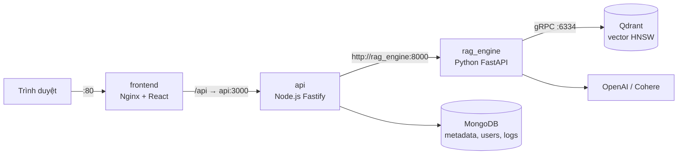

# Enterprise RAG System

Hệ thống hỏi–đáp trên tài liệu nội bộ theo kiến trúc **RAG (Retrieval-Augmented Generation)**: upload tài liệu (PDF, DOCX, Markdown, TXT, HTML), hệ thống tách đoạn, nhúng vector, lưu vào Qdrant; khi người dùng đặt câu hỏi, hệ thống tìm các đoạn liên quan, xếp hạng lại (rerank) và để LLM sinh câu trả lời **có trích dẫn nguồn**, trả về theo thời gian thực (streaming).

Dự án được xây dựng theo dạng **microservices đa ngôn ngữ**: React SPA · Node.js (Fastify) API Gateway · Python (FastAPI) RAG Engine · MongoDB · Qdrant, chạy toàn bộ bằng Docker Compose.

---

## Tính năng chính

- **Ingestion đa định dạng**: PyMuPDF, python-docx, markdown-it-py, BeautifulSoup4; **OCR tự động** cho PDF scan bằng `gpt-4o-mini` vision (có cache theo SHA-256).
- **Chống trùng lặp**: băm SHA-256 file upload, file đã có thì trả lại bản ghi cũ, không xử lý lại.
- **Tìm kiếm 2 tầng**: HNSW vector search trên Qdrant (Top-K = 50) → Cohere Rerank multilingual (Top-N = 3).
- **Query rewrite** cho câu hỏi nối tiếp trong hội thoại.
- **Guardrails**: phát hiện prompt injection, từ chối khi không có ngữ cảnh đủ tin cậy, giới hạn token ngữ cảnh.
- **Streaming SSE**: token hiển thị dần kèm danh sách trích dẫn.
- **Xác thực JWT**: access token (15 phút) + refresh token xoay vòng (cookie httpOnly, phát hiện tái sử dụng), phân quyền `admin` / `user`.
- **Đánh giá & benchmark**: bộ đánh giá RAG với LLM-judge, sweep tham số retrieval, stress test HNSW, đo độ trễ end-to-end.
- **CI**: GitHub Actions chạy test bằng mock provider (không cần API key) và build Docker image.

---

## Kiến trúc



| Service | Công nghệ | Cổng | Vai trò |
| --- | --- | --- | --- |
| `frontend` | React + Vite → Nginx 1.27 | 80 | Giao diện; reverse proxy `/api` sang API |
| `api` | Node.js 20 + Fastify + TypeScript | 3000 | API Gateway: xác thực, phân quyền, dedup, điều phối |
| `rag_engine` | Python 3.11 + FastAPI + Uvicorn | 8000 | Parse, chunk, embed, retrieve, rerank, generate |
| `mongodb` | MongoDB 7.0 | 27017 | `documents`, `users`, `refresh_tokens`, `query_logs` |
| `qdrant` | Qdrant v1.9.3 | 6333 (REST) / 6334 (gRPC) | Lưu vector + payload, chỉ mục HNSW |

Các service gọi nhau bằng tên service trong mạng Docker `rag_network`; người dùng chỉ cần truy cập `http://localhost` (cổng 80). Các cổng còn lại chỉ mở ra máy để tiện debug.

Chi tiết luồng dữ liệu, schema và quyết định kỹ thuật: xem [ARCHITECTURE.md](ARCHITECTURE.md).

---

## Cài đặt & chạy

### Yêu cầu
- Docker + Docker Compose v2
- API key OpenAI (embedding, LLM, OCR). Cohere API key (tuỳ chọn, cho reranker thật — có thể dùng Trial key).

### 1. Cấu hình biến môi trường
```bash
cp .env.example .env
```
Mở `.env` và điền tối thiểu:
```env
OPENAI_API_KEY=sk-...
COHERE_API_KEY=...                 # hoặc RERANKER_PROVIDER=mock
JWT_ACCESS_SECRET=<chuỗi ngẫu nhiên dài>
JWT_REFRESH_SECRET=<chuỗi ngẫu nhiên khác>
ADMIN_EMAIL=admin@rag.local
ADMIN_PASSWORD=<mật khẩu admin>
```
Tạo secret ngẫu nhiên: `openssl rand -hex 32`. **Không commit file `.env`** (đã có trong `.gitignore`).

> Không có API key? Đặt `LLM_PROVIDER=mock`, `RERANKER_PROVIDER=mock` và để trống `OPENAI_API_KEY` — hệ thống chạy được với provider giả lập (không có ý nghĩa ngữ nghĩa, chỉ để thử luồng).

### 2. Khởi động
```bash
docker compose up -d --build
docker compose ps          # đợi tất cả ở trạng thái healthy / running
```

### 3. Sử dụng
1. Mở **http://localhost**, đăng nhập bằng `ADMIN_EMAIL` / `ADMIN_PASSWORD`.
2. Upload tài liệu ở khung Documents (chỉ admin).
3. Đặt câu hỏi ở khung Chat — câu trả lời hiện dần kèm trích dẫn đoạn nguồn.

### Công cụ hữu ích
| Công cụ | Địa chỉ |
| --- | --- |
| Qdrant dashboard | http://localhost:6333/dashboard |
| RAG Engine API docs (Swagger) | http://localhost:8000/docs |
| MongoDB Compass | `mongodb://<MONGO_USER>:<MONGO_PASSWORD>@localhost:27017/?authSource=admin` |

Sau khi sửa `frontend/nginx.conf` hoặc code, build lại service tương ứng: `docker compose up -d --build <service>`.

---

## Cấu trúc thư mục

```
.
├── frontend/            React + Vite SPA, nginx.conf, Dockerfile (multi-stage)
├── api/                 API Gateway (Fastify + TypeScript)
│   ├── src/routes/      auth, documents, query (SSE), retrieval, augmentation, admin
│   ├── src/models/      Mongoose models
│   ├── src/services/    dedup, client gọi rag_engine, SSE collector
│   └── test_*.mjs       test route / auth / E2E
├── rag_engine/          RAG Engine (FastAPI)
│   ├── ingestion/       parser theo định dạng, OCR, chunking
│   ├── embeddings/      OpenAI / mock embedding provider
│   ├── vectordb/        Qdrant client, upsert / search
│   ├── retrieval/       tìm kiếm vector trên Qdrant
│   ├── rerankers/       Cohere / mock reranker
│   ├── prompting/       lắp ráp prompt, system prompt, ngân sách token
│   ├── generation/      pipeline truy vấn, query rewrite, streaming
│   ├── llm/             provider OpenAI / Anthropic / Gemini / mock
│   ├── evaluation/      bộ đánh giá RAG (dataset, LLM-judge, sweep)
│   ├── benchmarks/      stress test HNSW, đo độ trễ
│   ├── reports/         kết quả đánh giá (JSON + Markdown)
│   └── tests/           test Python
├── db/mongo_init/       script khởi tạo collection & index MongoDB
├── test_docs/           tài liệu mẫu để thử (PDF không được commit)
├── .github/workflows/   CI
├── docker-compose.yml
└── ARCHITECTURE.md      tài liệu kiến trúc chi tiết
```

---

## Kết quả đánh giá

Đánh giá trên 5 tài liệu PDF tiếng Việt / tiếng Anh (có 1 bản scan cần OCR), 59 câu hỏi (factual, paraphrase, follow-up, không thể trả lời), chấm bằng `gpt-4o-mini` làm judge.

| Cấu hình | Overall | Correctness | Groundedness | Follow-up | Từ chối đúng | Prompt tokens |
| --- | --- | --- | --- | --- | --- | --- |
| Baseline: chunk 512/64, k20, n5, prompt v1 | 0.796 | 0.821 | 0.954 | 0.533 | 7/8 | 2590 |
| **Chọn: chunk 256/32, k50, n3, rewrite, prompt v2** | **0.911** | **0.966** | 0.973 | **0.839** | **8/8** | 1301 |

- Retrieval Hit@3 / MRR: **0.941 / 0.866** khi có rerank (0.627 / 0.572 nếu không).
- HNSW (10k vector, gRPC): p95 **5.3 ms** @ 50 QPS, không lỗi tới 400 QPS, Recall@20 = 1.0.
- Độ trễ tới token đầu tiên (TTFT) p50 ≈ 2.0–2.3 s.

Báo cáo đầy đủ: [`rag_engine/reports/`](rag_engine/reports) và mục 6 của [ARCHITECTURE.md](ARCHITECTURE.md).

---

## Chạy test

```bash
# API Gateway (cần MongoDB đang chạy cho test_auth)
cd api && npm ci && npm run build
node test_dedup.mjs && node test_documents_route.mjs && node test_query_route.mjs
node test_e2e_flow.mjs          # E2E qua hệ thống đang chạy bằng docker compose

# RAG Engine (mock provider, Qdrant in-memory)
cd rag_engine && pip install -r requirements.txt
LLM_PROVIDER=mock RERANKER_PROVIDER=mock OPENAI_API_KEY= \
  PYTHONPATH=. sh -c 'for t in tests/test_*.py; do python "$t" || exit 1; done'
```

Chạy đánh giá RAG (cần API key thật, tốn phí nhỏ):
```bash
docker compose run --rm -v ./rag_engine:/app -v ./test_docs:/corpus:ro rag_engine \
  python -m evaluation.run_eval index --corpus /corpus --chunk 256:32:0
```
Các lệnh con khác: `build-dataset`, `retrieval-sweep`, `generate-eval` (xem `python -m evaluation.run_eval -h`).

---

## Định hướng phát triển

- Hybrid search (BM25 + vector) cho truy vấn chứa tên riêng, mã số.
- Hàng đợi ingestion bất đồng bộ cho tài liệu lớn.
- Phân quyền tài liệu theo nhóm người dùng.
- Reranker local (BGE qua ONNX) để giảm phụ thuộc dịch vụ ngoài.
- Dashboard theo dõi chất lượng và chi phí từ `query_logs`.
